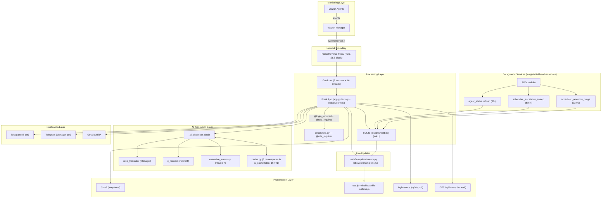

# Insight Shield — SYSTEM_DESIGN.md

> **Canonical technical reference**
> Insight Shield v1.5.0 · DLSL-IT Cybersecurity Capstone
> Repository: `https://github.com/Nekko-Innu/InsightShield-SIEM-Dashboard.git`
> Build 0.5.0
> Document generated: 2026-04-29 (post-Round-10 sign-off, v1.0.0 baseline)
> Last updated: 2026-07-29 (post-Round-J sign-off — SMS/Semaphore channel retired, v1.5.0)
> Document version: 2.3 — see footer revision-history block for full lineage. §§ 1–15 describe the v1.0 baseline (unchanged since the original sign-off, except where Round J notes mark current-state corrections); §16 documents Rounds A–J as deltas on top of that baseline.

---

## Table of Contents

1. [System Overview](#1-system-overview)
2. [Architecture Diagram](#2-architecture-diagram)
3. [Technology Stack](#3-technology-stack)
4. [Database Schema](#4-database-schema)
5. [Configuration & Settings](#5-configuration-settings)
6. [AI Translation Pipeline](#6-ai-translation-pipeline)
7. [Notification & Alert Routing](#7-notification-alert-routing)
8. [Dashboard UI/UX](#8-dashboard-uiux)
9. [Real-Time Updates (SSE)](#9-real-time-updates-sse)
10. [Agent & Status Monitoring](#10-agent-status-monitoring)
11. [RBAC (Role-Based Access Control)](#11-rbac-role-based-access-control)
12. [Administrative Tools](#12-administrative-tools)
13. [Deployment & Operations](#13-deployment-operations)
14. [Visual Design Rules (Standing Order)](#14-visual-design-rules-standing-order)
15. [Protected Design Decisions](#15-protected-design-decisions)

---

## 1. SYSTEM OVERVIEW

Insight Shield is a real-time SIEM dashboard built on top of Wazuh. It consumes alerts from a Wazuh manager via a webhook, enriches them with AI-generated plain-language translations and IT investigation guidance, and routes notifications to IT staff and a non-technical manager via Telegram and email (the SMS/Semaphore channel was retired in Round J). The system replaced the WatchPost project as a clean-break rebuild: fresh database, no migration framework, retired manager-acknowledgment and simulation panel, encrypted credential store, role-aware access control, push-driven Server-Sent Events on the IT dashboard.

**Target users**:

- **IT Admin** — full access; manages alert lifecycle (acknowledge → resolve), reads AI-generated IT recommendations on alert detail, configures AI providers and notification gateways, runs Security Audit Reports, downloads CSV exports.
- **Manager** — read-only observer; sees a simplified dashboard with health score, monitored devices, and an alert feed; can view audit reports but cannot access settings, raw data, IT-only investigation steps, or acknowledge/resolve actions.

**Core alert lifecycle**:

1. **Ingestion** — Wazuh Manager forwards alerts via webhook to `POST /wazuh-webhook` (loopback-restricted).
2. **AI Translation** — A chain of configured AI providers generates a *Manager Translation* (≤100 words in three sections: WHAT HAPPENED, HOW SERIOUS, WHAT TO DO). A second fire-and-forget AI call produces *IT Recommendation* (INVESTIGATE / CHECK / MITIGATE) — visible only to IT_ADMIN on alert detail.
3. **Severity Routing** — Wazuh rule level (2-15) maps to severity (INFORMATIONAL/LOW/MEDIUM/HIGH/CRITICAL); after-hours escalation may bump one tier; the routing matrix in §7 selects channels.
4. **Push to dashboard** — `wazuh_receiver.process_alert` publishes nothing. It stores the row and returns; every open `/api/events/stream` notices `MAX(id)` on the `alerts` table has moved on its next 2 s poll tick and emits `new_alert` itself (see §9). IT dashboard prepends the row in real time; manager dashboard polls the alert feed every 15s.
5. **Acknowledgment** — IT Admin acknowledges via `POST /alert/<id>/acknowledge`; `response_time_s` is recorded.
6. **Resolution** — IT Admin resolves with a note via `POST /alert/<id>/resolve`; the manager Telegram bot receives a closure notification via `notifier.send_manager_resolution_notification`.

**After-hours escalation** (`alert_router.is_outside_hours`): when the current PHT hour is `< 8` or `>= 21`, severity escalates one tier (MEDIUM → HIGH, HIGH → CRITICAL). INFORMATIONAL/LOW/CRITICAL are unchanged — no double-escalation. The escalation happens before the routing matrix is consulted.

**Daily housekeeping** (APScheduler — see §7.5). Five jobs, all registered by `scheduler.init_scheduler()`, which **exactly one process** may call — in production that is `insightshield-worker.service`, not a gunicorn worker:

- `midnight_health_reset` — cron 00:00 PHT; logs the rolling-24h window flip.
- `daily_db_backup` — cron 02:00 PHT; runs `backup.run_daily_backup`.
- `retention_purge` — cron 03:00 PHT; `db.purge_old_rows(audit_days=config.AUDIT_RETENTION_DAYS, error_days=config.ERROR_RETENTION_DAYS)` plus a WAL checkpoint. Runs after the 02:00 backup so the backup still captures the pre-purge state.
- `agent_status_poll` — interval 30 s; calls `agent_status.refresh()`, which writes the snapshot to the `settings` table. It publishes nothing — the write itself is the notification (see §10.1).
- `escalation_sweep` — interval `config.ESCALATION_INTERVAL_MIN` (5 min); one sweep over `db.get_unacked_critical_alerts(...)`, not one job per alert. Acknowledgment takes effect because the next sweep re-reads the alert row.

---

## 2. ARCHITECTURE DIAGRAM



**Data-flow notes**:

- The Wazuh webhook handler is loopback-restricted at the Flask layer (`request.remote_addr in ALLOWED_WEBHOOK_IPS`).
- After `db.store_alert`, the receiver spawns a fire-and-forget thread that runs the IT recommender and writes `it_recommendation` back to the alert row. That is all it does — it publishes nothing and renders nothing. Both `new_alert` (with server-rendered `_alert_row.html` HTML) and `severity_update` (with the array-shaped severity breakdown) are emitted by `/api/events/stream` itself once its poll tick sees the new row id.
- There is **no** SSE registry and no in-process queue. Each open stream independently polls `db.get_stream_watermark()` — `MAX(id)` on `alerts` plus the `updated_at` of the `agent_status.snapshot` settings row — and decides for itself what to emit (see §9). This is what lets a browser attached to worker A see an alert ingested by worker B.
- Manager dashboard never touches SSE — it polls `/api/alerts/latest` every 15 s for an "alerts available, refresh to view" toast.

---

## 3. TECHNOLOGY STACK

| Component             | Technology / Library                                         | Purpose |
|-----------------------|--------------------------------------------------------------|---------|
| Backend runtime       | Python 3.12, Flask 3.x — `app.create_app()` factory, routes in `web/blueprints/` | Web framework, routing, session management |
| WSGI server           | gunicorn 22 (sync workers, 3 × 16 threads, 127.0.0.1:5000)   | Production WSGI |
| Process supervisor    | systemd (`insightshield.service` web tier + `insightshield-worker.service` scheduler) | Auto-restart, hardening (`NoNewPrivileges`, `ProtectSystem=strict`) |
| Database              | SQLite 3, WAL journaling, `synchronous=NORMAL`               | Single-file store at `insightshield.db` |
| Auth                  | Flask-Login + Werkzeug `scrypt` password hashing             | Session cookies; `PERMANENT_SESSION_LIFETIME_MIN = 30` |
| Encryption            | `cryptography.fernet.Fernet`                                  | Encrypts `api_keys.encrypted_value`; master key in `.env` only |
| RBAC                  | `decorators.role_required(role)` (Round 8)                   | 26 routes protected across the nine blueprints; path-based 403 JSON / 302 dispatch |
| Scheduling            | APScheduler 3.x (`BackgroundScheduler`, Asia/Manila)         | Health reset, daily backup, agent-status poll, escalation |
| AI providers          | Groq, Gemini, OpenRouter (default chain); OpenAI, DeepSeek, Anthropic, Custom (templates) | Manager translation, IT recommendation, exec summary |
| AI chain              | `_ai_chain.run_chain` — single runner, three callers         | See §6 |
| Cache                 | `cache.py` — three namespaces, in-memory, 1 h TTL, `threading.Lock` | manager / it_rec / exec_summary |
| Telegram              | Bot API (`api.telegram.org/bot{token}/sendMessage`)          | IT group + Manager bot (separate tokens) — primary outbound channel; SMS/Semaphore retired in Round J |
| Email                 | Gmail SMTP (app password)                                    | HIGH/CRITICAL backup channel |
| Wazuh integration     | Wazuh Manager REST API                                       | Agent status snapshot |
| Frontend CSS          | Tailwind CDN with offline `static/vendor/` fallback          | Plus `static/design-tokens.css` (single source for tokens) |
| Frontend JS           | Vanilla ES (no framework) — `sse.js`, `dashboard-it-realtime.js`, `login-status.js`, `settings.js`, `ui.js` | SSE client, polling fallback, range buttons, toasts |
| Icons                 | Heroicons v2 outline via `templates/_icon.html` macro         | No emoji, no icon fonts (see §14) |
| Reverse proxy         | nginx 1.24, self-signed TLS                                   | Static asset serving, SSE block (`proxy_buffering off`, 3600s timeout) |

---

## 4. DATABASE SCHEMA

Schema is created from scratch by `db.init_db()` on first boot. **No migration framework** — `init_db()` uses `CREATE TABLE IF NOT EXISTS` and is fully idempotent. Nine tables; the `alerts` table has 21 columns.

> **Known gap.** "No migration framework" is a real constraint, not just a simplification.
> `init_db()` contains no `ALTER TABLE`, no `PRAGMA table_info` check and no `user_version`
> tracking, so `CREATE TABLE IF NOT EXISTS` is a no-op against an existing database. A column
> added to a table definition here reaches fresh installs only — an already-deployed database
> keeps its old shape and starts failing on the first INSERT that names the new column.
> Schema changes to a live install currently require a hand-written migration run out of band.

The three newest tables all exist because per-worker process memory was the wrong home for
shared state once the app ran under more than one gunicorn worker:

| Table | Replaced | Failure it fixed |
|---|---|---|
| `ai_cache` | three in-memory dicts in `cache.py` | "50 alerts = 1 API call" degraded to one call *per worker*, and the whole cache was lost on restart |
| `rate_events` | an in-process counter in `rate_limit.py` | each worker enforced its own quota, so the effective rate limit was N× the configured one |
| `error_log` | nothing — new surface | backend and client-side errors now land in one queryable place, shown in Settings → Errors |

### 4.1 `alerts` (21 columns)

```sql
CREATE TABLE IF NOT EXISTS alerts (
    id                  INTEGER PRIMARY KEY AUTOINCREMENT,
    timestamp           TEXT    NOT NULL,
    rule_id             TEXT    NOT NULL,
    attack_type         TEXT    NOT NULL,
    severity            TEXT    NOT NULL,
    device_name         TEXT    NOT NULL,
    raw_alert           TEXT    NOT NULL,
    plain_text          TEXT,
    ai_reasoning        TEXT,
    provider_used       TEXT,
    fk_grade            REAL,
    acknowledged        INTEGER DEFAULT 0,
    acknowledged_by     TEXT,
    acknowledged_at     TEXT,
    response_time_s     INTEGER,
    attack_trail        TEXT,
    resolved            INTEGER DEFAULT 0,
    resolved_by         TEXT,
    resolved_at         TEXT,
    resolve_note        TEXT,
    it_recommendation   TEXT
);
```

- `severity` is one of the strings `INFORMATIONAL`, `LOW`, `MEDIUM`, `HIGH`, `CRITICAL` (full words, not abbreviations).
- `raw_alert` is the unmodified Wazuh JSON payload as a string. `attack_trail` is a JSON-encoded enrichment block (rule context, decoder, MITRE, etc.) populated by `wazuh_receiver`.
- `fk_grade` is a Flesch–Kincaid readability score from `textstat` — log-only, never used to gate routing.
- `it_recommendation` is populated asynchronously by a fire-and-forget worker; the alert is visible on the dashboard before this column is filled.

### 4.2 `users`

```sql
CREATE TABLE IF NOT EXISTS users (
    id                    INTEGER PRIMARY KEY AUTOINCREMENT,
    username              TEXT UNIQUE NOT NULL,
    password_hash         TEXT NOT NULL,
    role                  TEXT NOT NULL,
    created_at            TEXT NOT NULL,
    must_change_password  INTEGER DEFAULT 0
);
```

`role` is plain TEXT — there is **no CHECK constraint**; valid values (`'IT_ADMIN'`, `'manager'`) are enforced by application code in `decorators.role_required`. Bootstrap accounts have `must_change_password=1` so the first login forces a password change.

### 4.3 `audit_log`

```sql
CREATE TABLE IF NOT EXISTS audit_log (
    id          INTEGER PRIMARY KEY AUTOINCREMENT,
    ts          TEXT NOT NULL,
    actor       TEXT,
    actor_role  TEXT,
    action      TEXT NOT NULL,
    target      TEXT,
    ip          TEXT,
    user_agent  TEXT,
    details     TEXT
);
CREATE INDEX idx_audit_ts    ON audit_log(ts);
CREATE INDEX idx_audit_actor ON audit_log(actor);
```

Populated by `web/hooks.py`'s `_audit_request` (a `@before_request` middleware) for every authenticated mutating request, and by explicit `db.log_audit` calls inside settings POSTs and alert lifecycle handlers. Only POST/PUT/PATCH/DELETE are considered at all, and high-frequency endpoints are excluded via `AUDIT_SKIP_PREFIXES` (see §5.4).

### 4.4 `api_keys`

```sql
CREATE TABLE IF NOT EXISTS api_keys (
    id              INTEGER PRIMARY KEY AUTOINCREMENT,
    service         TEXT NOT NULL,
    key_name        TEXT NOT NULL,
    encrypted_value TEXT NOT NULL,
    is_active       INTEGER DEFAULT 1,
    created_at      TEXT NOT NULL,
    updated_at      TEXT NOT NULL
);
CREATE UNIQUE INDEX idx_apikeys_lookup ON api_keys(service, key_name);
```

Stores **non-AI** service credentials (Telegram bots, Gmail, Wazuh REST password). Every value is Fernet-encrypted; the master key lives in `.env`. AI provider keys live in `ai_providers.api_key_encrypted` (next table). Round J (2026-07-29) retired the Semaphore SMS gateway; pre-existing `service='semaphore'` rows are orphaned, unread data.

### 4.5 `settings`

```sql
CREATE TABLE IF NOT EXISTS settings (
    key        TEXT PRIMARY KEY,
    value      TEXT NOT NULL,
    updated_at TEXT NOT NULL
);
```

Plain-text non-secret config: phone numbers, sender names, chat IDs, recipient emails, Wazuh URL/user. The `bootstrap_complete` sentinel key is set to `1` after the first-boot import so subsequent boots don't re-seed.

### 4.6 `ai_providers`

```sql
CREATE TABLE IF NOT EXISTS ai_providers (
    id                  INTEGER PRIMARY KEY AUTOINCREMENT,
    label               TEXT    NOT NULL,
    model               TEXT    NOT NULL,
    api_key_encrypted   TEXT    NOT NULL,
    base_url            TEXT    NOT NULL,
    auth_header         TEXT    NOT NULL,
    auth_prefix         TEXT    NOT NULL DEFAULT '',
    request_format      TEXT    NOT NULL,
    is_active           INTEGER NOT NULL DEFAULT 1,
    position            INTEGER NOT NULL,
    created_at          TEXT    NOT NULL,
    updated_at          TEXT    NOT NULL
);
CREATE UNIQUE INDEX idx_ai_providers_label           ON ai_providers(label);
CREATE INDEX        idx_ai_providers_active_position ON ai_providers(is_active, position);
```

`db.get_active_providers_ordered()` returns rows where `is_active = 1` ordered by `position`, decrypts `api_key_encrypted`, and returns dicts in the canonical shape consumed by `_ai_chain.run_chain`. The chain runner does not change between rounds; only the source of the list does (Round 2 read from `config.DEFAULT_AI_PROVIDERS`; Round 3+ reads from this table).

> The Round 3 plan called for a `rate_limit_per_min INTEGER NULL` column on this table to generalise the burst gate. **It did not ship** — the inline `if label.lower() == "groq"` check in `_ai_chain.run_chain:80-100` is still hardcoded against `config.GROQ_BUDGET_PER_MIN`. Open gap.

### 4.7 Round 7 report helpers

`db.py` exposes six helpers consumed by the Security Audit Report (see §12.1):

- `get_severity_breakdown(hours=24) -> dict` — counts keyed by severity string, fixed key order.
- `get_top_threats(date_from, date_to, n=3) -> list[dict]` — `[{attack_type, count}, ...]` ordered by count desc.
- `get_top_attacker_ips(date_from, date_to, n=5) -> list[dict]` — uses `alerts_util.derive_attacker_ip` so the four-fallback derivation chain is single-source. The helper was moved out of `app.py` into a leaf module precisely so `db.py` could import it at module scope instead of dodging a circular import with a function-local import.
- `get_auth_metrics(date_from, date_to) -> dict` — `{success, failure}` derived from `attack_trail.rule.groups`.
- `get_posture_score(date_from, date_to) -> int` — `0..100`, mirrors `health_score.calculate` deduction model over an arbitrary window.
- `get_latest_alert_id_in_range(date_from, date_to) -> int` — feeds the exec-summary cache key.

---

## 5. CONFIGURATION & SETTINGS

### 5.1 `.env` file

Credentials and service settings are read from `.env` at first boot only, then live in the database. A second group of runtime knobs is read from the environment on **every** boot and never moves into the database — `WAZUH_WEBHOOK_TOKEN`, `WAZUH_API_VERIFY`, `COOKIES_REQUIRE_HTTPS`, `REPORT_PDF_PER_MIN`, `REPORT_MAX_RANGE_DAYS`, `REPORT_ASSET_BASE_URL`, `AUDIT_RETENTION_DAYS`, `ERROR_RETENTION_DAYS`, and the bootstrap passwords among them.

The three that must be set before the app will work at all:

```
FLASK_SECRET_KEY=<openssl rand -hex 32>
ENCRYPTION_KEY=<Fernet.generate_key().decode()>
WAZUH_WEBHOOK_TOKEN=<openssl rand -hex 32>
```

`insightshield/.env.example` is the authoritative list — `config.py` reads roughly twenty variables and enumerating them here only guarantees this section goes stale.

> **First-boot import is one-shot and does not ignore placeholders.** `bootstrap_settings_from_env` skips only *empty* values, so a placeholder left in `.env` (`GROQ_API_KEY=your-groq-api-key-here`) is imported as though it were a real credential. It is guarded by a `bootstrap_complete` sentinel, so editing `.env` afterwards does not re-run it. Blank what you are not setting. Recovery: `insightshield/docs/runbook.md`.

`crypto_utils.get_master_key()` is called at the top of `app.py`, before the app is built. If `ENCRYPTION_KEY` is missing or invalid, the call exits the process with a fatal log message — systemd reports the unit as failed. This is **fail-loud**: running with a broken key would silently emit empty/corrupt API keys to providers, which is worse than refusing to boot.

### 5.2 Bootstrap process

When both `settings` and `api_keys` are empty (first boot only), `db.bootstrap_settings_from_env` and `db.bootstrap_api_keys_from_env` populate them from `.env`-supplied seed values:

- `settings`: manager phone, IT admin phone, IT admin email (contact-record fields only since Round J), Gmail address (plain), Telegram chat IDs, Wazuh API URL/user.
- `api_keys` (Fernet-encrypted): Telegram IT bot token, Telegram manager bot token, Gmail app password, Wazuh API password.
- `ai_providers`: seeded from `config.DEFAULT_AI_PROVIDERS` (Groq, Gemini, OpenRouter — three rows) with their API keys Fernet-encrypted.

A sentinel row (`settings.key = 'bootstrap_complete'`, `value = '1'`) is set last. Subsequent boots skip the bootstrap entirely.

### 5.3 Settings page (`/admin/settings`)

IT_ADMIN-only (Round 8 decorator). Vertical tabs at the left: **Service Configuration | Audit Log | Backups | Errors**. `templates/settings.html` whitelists `('service', 'audit', 'backups', 'errors')`; the Errors tab is served by `web/blueprints/admin_settings.py` off the `error_log` table and shows backend exceptions and browser-side error beacons together. The right panel uses Jinja `include` to render `audit.html` and `backups.html` as inner partials — Round 3 collapsed the standalone `/admin/audit` and `/admin/backup` routes into `/admin/settings?tab=audit|backups` 302 redirects to keep one UI surface.

Service Configuration contains seven sub-sections, each with its own Save button:

| Sub-section                  | Stored in       | Encrypted? |
|------------------------------|-----------------|------------|
| 1. AI Providers              | `ai_providers`  | Per-row API key encrypted; everything else plain |
| 2. Telegram – IT Group       | `api_keys`      | Bot token encrypted; Chat ID in `settings` |
| 3. Telegram – Manager        | `api_keys`      | Bot token encrypted; Chat ID in `settings` |
| 4. Gmail SMTP                | `api_keys`      | App password encrypted; Email in `settings` |
| 5. Notification Recipients   | `settings`      | Manager Phone, IT Phone, IT Email — plain, contact-record only (Round J) |
| 6. Wazuh API                 | `settings`+`api_keys` | URL/User plain; Password encrypted |

> SMS Gateway (Semaphore) sub-section removed in Round J (2026-07-29).

The AI Providers sub-section supports add / remove / reorder via up/down arrows, an Active toggle, and a Pre-built Templates dropdown sourced from `config.PROVIDER_TEMPLATES` (Groq, OpenAI, Gemini, DeepSeek, Anthropic, OpenRouter, Custom). Selecting a template auto-fills `base_url`, `auth_header`, `auth_prefix`, and `request_format` so the operator only enters a label and API key.

Reveal-key flow is CSRF-protected. The reveal endpoint returns the decrypted value briefly; client-side JS in `static/js/settings.js` masks it again after 10 s.

### 5.4 Audit middleware skip list

`web/hooks.py`'s `AUDIT_SKIP_PREFIXES` excludes high-frequency endpoints from the per-request audit log. Without this, every browser tab would write 4-5 audit rows per minute and bury real audit events under polling noise.

```python
AUDIT_SKIP_PREFIXES = (
    "/api/alerts/latest",
    "/api/health-score",
    "/api/cache-stats",
    "/api/severity-breakdown",
    "/api/agents",
    "/api/events/stream",  # Round 4: long-lived SSE — would flood audit_log
    "/api/status",         # Round 5: public 30s poll from login page
    "/api/client-error",   # error beacon — already lands in error_log, not audit_log
    "/health",
    "/static/",
)
```

The prefix list is the second filter, not the first. The hook audits only mutating methods:

```python
AUDIT_METHODS = {"POST", "PUT", "PATCH", "DELETE"}
```

A GET never reaches the prefix check at all, which is what stopped ordinary page navigation from flooding `audit_log`.

---

## 6. AI TRANSLATION PIPELINE

### 6.1 High-level flow

```
Wazuh webhook -> validate -> map level→severity -> derive attack_type ->
    run_chain(prompt, providers, validator) for manager translation
        ↳ stores ai_reasoning + provider_used + fk_grade
    db.store_alert -> publish new_alert + severity_update SSE events
    spawn fire-and-forget thread:
        run_chain(prompt, providers, validator) for IT recommendation
            ↳ stores it_recommendation
    alert_router.route_alert -> Telegram / Email per matrix
```

### 6.2 `_ai_chain.run_chain`

```python
def run_chain(
    prompt: str,
    providers: list[dict],
    validator_fn: Callable[[str], bool],
    cache_get: Optional[Callable[[str], Optional[str]]] = None,
    cache_set: Optional[Callable[[str, str], None]] = None,
    cache_key: Optional[str] = None,
) -> tuple[str, str, str]:
    """Returns (text, provider_used, reasoning).

    provider_used = "cache" | <provider['label']> | AI_CHAIN_EXHAUSTED
    """
```

- **Provider iteration**: walks the list as-is. Skips entries with `is_active=False` or empty `api_key`.
- **Caching**: if `cache_get(cache_key)` returns a value, the function returns immediately with `provider_used="cache"`. On a successful provider call the result is passed to `cache_set` before returning.
- **Validator**: each provider response is fed through `validator_fn`. A response that fails validation is treated as a chain miss; the next provider is tried.
- **Rate limiting**: only the `groq` label gets an inline rate gate (`rate_limit.can_call("groq", config.GROQ_BUDGET_PER_MIN)`) — Round 3's `rate_limit_per_min` column was planned but not shipped.
- **Sentinel**: when every active provider fails, the function returns `(AI_CHAIN_EXHAUSTED, AI_CHAIN_EXHAUSTED, reasoning)`. Callers either substitute a static fallback (manager translator) or store the sentinel verbatim (IT recommender).

### 6.3 Three callers

| Caller | Validator | Cache namespace | Obfuscation | Static fallback |
|--------|-----------|-----------------|-------------|-----------------|
| `groq_translator.translate_alert` | `validate_manager_translation` | `manager` (key = `rule_id`) | None | Yes — per-rule canned text |
| `it_recommender.recommend` | `validate_it_recommendation` | `it_rec` (key = SHA-256 of the **obfuscated** prompt) | Per-alert map from `_build_map`: internal IPs → `Device-A/B/…`, agent name → `Host-A/…`, plus static `3389`/`mimikatz.exe`/`lsass.exe` — applied before the prompt leaves the perimeter; deobfuscated through the same alert's map before storage | No — stores `AI_CHAIN_EXHAUSTED` sentinel; template renders fallback copy |
| `executive_summary.generate` (Round 7) | `validate_exec_summary` | `exec_summary` (key = SHA-1 digest of `date_from|date_to|latest_alert_id_in_range`, 16-hex truncate) | None | Static fallback paragraph in `report.html` |

The IT recommender uses the **same** provider order as the manager translator — both call `_request_cache.cached_active_providers()`. There is no reversal.

### 6.4 Validators (`validator.py`)

| Function | Hard-rejection rules |
|----------|----------------------|
| `validate_manager_translation` | Contains `WHAT HAPPENED:` AND `WHAT TO DO:`; word count ≤ `MAX_WORDS=100`; no forbidden word from `config.FORBIDDEN_WORDS` (19 entries) |
| `validate_it_recommendation` | Contains `INVESTIGATE:`, `CHECK:`, `MITIGATE:`; word count ≤ 100; **no** forbidden-word check (IT staff need TCP/RDP/SMB/etc.) |
| `validate_exec_summary` | ≥ 2 paragraphs (separated by blank line); 150 ≤ words ≤ 400; no forbidden word |
| `compute_fk_grade` | Log-only; never used to reject |

### 6.5 Request-format dispatch

`_ai_chain._call_provider` dispatches on the `request_format` key:

| Format               | API style                  | System prompt placement | Auth header default      |
|----------------------|----------------------------|-------------------------|--------------------------|
| `openai_compat`      | OpenAI chat completions    | `messages[0]` role=system | `Authorization: Bearer ` |
| `gemini_v1beta`      | Gemini generateContent     | `system_instruction` top-level | `x-goog-api-key`     |
| `anthropic_messages` | Anthropic Messages         | `system` top-level      | `x-api-key`              |

> **Known gap**: `_call_anthropic_messages` raises `NotImplementedError`. Adding an Anthropic provider via Settings causes the chain to skip it and fall through. Implement when the first client actually uses it.

### 6.6 Cache (`cache.py`)

Three namespaces, each a `dict[str, dict]` guarded by a single `threading.Lock`:

- `_cache` — manager translations, keyed by `rule_id`.
- `_itrec_cache` — IT recommendations, keyed by `rule_id`.
- `_exec_cache` — exec summaries, keyed by SHA-1 digest (Round 7).

Per-entry shape: `{"text": str, "ts": float, "hits": int}`. TTL is `cache.TTL = 3600` seconds; entries are evicted lazily on read after expiry. `get_stats()` returns counts per namespace for the IT-only `/api/cache-stats` endpoint.

---

## 7. NOTIFICATION & ALERT ROUTING

### 7.1 Severity mapping (`wazuh_receiver.LEVEL_MAP`)

```python
LEVEL_MAP = {
    2: "INFORMATIONAL", 3: "INFORMATIONAL", 4: "INFORMATIONAL",
    5: "LOW", 6: "LOW", 7: "LOW",
    8: "MEDIUM", 9: "MEDIUM",
    10: "HIGH", 11: "HIGH", 12: "HIGH",
    13: "CRITICAL", 14: "CRITICAL", 15: "CRITICAL",
}
```

Wazuh rule levels 0-1 return `None` from `map_level_to_severity` and are **discarded silently** (they're informational system noise). Levels above 15 are treated as `CRITICAL` with a warning log.

### 7.2 Routing matrix

`alert_router.route_alert` applies after-hours escalation **first**, then dispatches by post-escalation severity:

| Severity (post-escalation) | IT Telegram | IT Email | Manager Telegram | 5-min escalation repeat |
|----------------------------|-------------|----------|------------------|-------------------------|
| INFORMATIONAL              | No          | No       | No               | No                      |
| LOW                        | No          | No       | No               | No                      |
| MEDIUM                     | Yes (deduped per `rule_id`, 1/10min) | No | No | No |
| HIGH                       | Yes         | Yes      | Yes              | No                      |
| CRITICAL                   | Yes         | Yes      | Yes              | **Yes**                 |

> SMS (IT SMS column, Semaphore-backed) retired in Round J (2026-07-29). Telegram + Email are the complete active channel set.

### 7.3 After-hours escalation

`alert_router.is_outside_hours()` returns `True` when the current `Asia/Manila` hour is `< config.BUSINESS_START` (8) or `>= config.BUSINESS_END` (21). When true, `escalate_one_tier`:

```python
{"MEDIUM": "HIGH", "HIGH": "CRITICAL"}
```

Note: INFORMATIONAL and LOW are **not** escalated (they remain dashboard-only) and CRITICAL is not double-escalated.

### 7.4 Flood control (`rate_limit.py`)

Thread-safe, in-memory sliding-window buckets with a single `threading.Lock`. The active buckets:

- `groq` — `config.GROQ_BUDGET_PER_MIN = 25` calls/min (Groq free-tier ceiling is 30; 25 leaves retry headroom).
- `tg-medium:<rule_id>` — 1 call per 600 s (10 min) per rule, used by `alert_router` to dedupe MEDIUM Telegram floods.

> The `sms:<device>` bucket (1 call per 300s per device, HIGH/CRITICAL SMS) was removed in Round J alongside the SMS channel.

`can_call(label, limit_per_min, window_seconds=60)` returns `(allowed: bool, retry_after: float)`.

### 7.5 Critical escalation repeat

When `route_alert` dispatches a CRITICAL alert, it calls `scheduler.register_escalation(alert_id)`. The scheduler registers an APScheduler `interval` job:

```python
_scheduler.add_job(
    _escalation_tick,
    trigger="interval",
    minutes=config.ESCALATION_INTERVAL_MIN,   # = 5
    args=[alert_id],
    id=f"escalation_{alert_id}",
    replace_existing=True,
)
```

Every 5 minutes `_escalation_tick` checks `db.get_alert(alert_id)`. If `acknowledged == 1` it calls `cancel_escalation` and exits. Otherwise it re-sends IT Telegram, Email, and manager Telegram. The job is also cancelled by the `/alert/<id>/acknowledge` handler.

> §7.6 previously documented `notifier.SMS_TEMPLATES` (5 severity/attack_type-keyed 155-char templates, `build_sms`, `_enforce_limit`). Removed in Round J along with the rest of the SMS/Semaphore integration — see `REBUILD_SPEC.md` Part 23.

### 7.6 Telegram templates

`notifier.send_telegram` (IT group) and `send_manager_telegram` use ASCII box-drawing characters (`━━━`) to delimit sections. **No emoji** — the no-emoji standing rule applies to outbound channels too. The IT body includes provider/FK diagnostics; the manager body strips those for a cleaner read.

`send_manager_resolution_notification` sends a short plain-text message after an IT resolve, also via the manager bot — same chat as `send_manager_telegram`.

### 7.7 Email

Gmail SMTP via app password. HTML body that includes the full manager translation (three sections) and a deep link back to `/alert/<id>`.

---

## 8. DASHBOARD UI/UX

### 8.1 Design tokens (`static/design-tokens.css`)

Severity palette — five severities × three tones (bg/border/fg):

```css
--sev-info-bg:  #eff6ff;  --sev-info-fg:  #1e40af;  --sev-info-border:  #3b82f6;
--sev-low-bg:   #ecfdf5;  --sev-low-fg:   #065f46;  --sev-low-border:   #10b981;
--sev-med-bg:   #fffbeb;  --sev-med-fg:   #92400e;  --sev-med-border:   #f59e0b;
--sev-high-bg:  #fff7ed;  --sev-high-fg:  #9a3412;  --sev-high-border:  #ea580c;
--sev-crit-bg:  #fef2f2;  --sev-crit-fg:  #991b1b;  --sev-crit-border:  #dc2626;
```

Status palette — three states (Round 5):

```css
--status-online:    #10b981;   /* green   — manager + all agents online */
--status-degraded:  #f59e0b;   /* amber   — manager online, ≥1 agent offline */
--status-offline:   #dc2626;   /* red     — manager unreachable */
```

### 8.2 Reusable primitives

`.dot` class (single source for every coloured circle):

```css
.dot      { display: inline-block; width: 12px; height: 12px; border-radius: 50%; flex-shrink: 0; }
.dot--sm  { width: 10px; height: 10px; }
```

Caller passes color via `style="background-color: var(--TOKEN);"`. Used by login-page status, manager dashboard monitored devices, severity bar chart rows, and alert detail headers.

`` macro from `templates/_icon.html` — every icon in the dashboard is an inline Heroicons v2 outline SVG. Branches present: `arrow-left`, `cog-6-tooth`, `eye`, `eye-slash`, `chevron-up`, `chevron-down`, `trash`, `pencil`, `lock-closed` (added in Round 10 to replace a residual `🔒` emoji on `password_change.html`).

### 8.3 Header navigation order (`templates/_base.html`)

Set in Round 9:

- **IT_ADMIN**: `[role badge] | Dashboard | Security Audit Report | Export CSV | [gear] Settings | Change password | Log out`
- **Manager**: `[role badge] | Dashboard | Security Audit Report | Change password | Log out`

The `Dashboard` link points at the role-aware `/dashboard` alias, which 302-redirects to `/dashboard/it` or `/dashboard/manager` based on `current_user.role` via `_dashboard_for_role()`.

### 8.4 Page-by-page

**Login (`templates/login.html`)** — split-screen branding + form. Live agent status: a `dot dot--sm` element with `data-status-dot` plus per-device dots populated by `static/js/login-status.js` polling `/api/status` every 30 s. The default token is `var(--status-online)`; the JS swaps to `var(--status-degraded)` or `var(--status-offline)` based on the snapshot's `dot_color`.

**IT Dashboard (`templates/dashboard_it.html`)** — toolbar (severity filters, search, Export CSV, Security Audit Report); four-card KPI strip (fixed layout since Round J removed the SMS credits card — was a conditional 5th card before that):

| Position | Label                                   | Source |
|----------|-----------------------------------------|--------|
| 1        | Open alerts                             | unacked alert count |
| 2        | Awaiting ack                            | unacked HIGH/CRITICAL count (`db.count_awaiting_ack`); red when > 0. Replaced 24h MTTA, which stays in `db.mtta_seconds` for reporting |
| 3        | Active agents                           | from `get_agent_status()` |
| 4        | `<primary_provider> used`               | label of the top-position active provider + cache hit count |

Alerts table is `<table class="table-fixed">` — fixed colgroup widths so SSE-prepended rows don't reflow. Severity bar chart below: rows in **crit → high → med → low → info** order (Round 6 reversal — Critical at top, per master spec). 24h / 7d / 30d range buttons re-fetch `/api/severity-breakdown?range=...`.

**Manager Dashboard (`templates/dashboard_manager.html`)** — health-score gauge, monitored devices grid using `.dot` class with `--status-online/offline` tokens, alerts feed (15 s polling). **No** acknowledge button — manager-ACK was removed in Round 1 (clean break from the WatchPost lineage; manager is purely observational).

**Alert Detail (`templates/alert_detail.html`)** — hero with severity badge, manager translation section ("Translated by `<provider>`" badge), IT-only "Recommended Investigation Steps" section gated by `current_user.role == 'IT_ADMIN'`, forensic detail block (decoded from `attack_trail`), lifecycle timeline, raw JSON `<details>` block. ACK and Resolve modals with CSRF tokens.

**Settings (`/admin/settings`)** — see §5.3.

**Security Audit Report (`/report`)** — see §12.1.

### 8.5 Alert row partial (`templates/_alert_row.html`)

Single `<tr>` partial used by both `dashboard_it.html`'s initial render (looped via ``) and the SSE stream in `web/blueprints/stream.py`, which renders it per new row and ships it in the `new_alert` event's `row_html` field. Single source of truth for row markup — schema or copy changes propagate to both initial render and live SSE prepend. (The webhook used to render this on every ingest whether or not anyone was watching; it is now rendered only when a stream is open to receive it.)

The MEDIUM-frequency `(N/M)` badge (Round 6) renders only when `severity == 'medium'` AND `attack_trail.rule.frequency` is set: `(firedtimes/threshold)` with `title="N out of M occurrences needed to escalate to HIGH"`.

### 8.6 Print CSS

`@media print` hides nav, toolbar, and modal overlays; converts cards to thin borders; forces `page-break-before: always` on every `h2`, with `:first-of-type` exempted so the report doesn't open with a forced blank page.

Global print and responsive rules live in `static/design-tokens.css`; report-only print rules live in `static/report-bureau.css`. Both are linked from `templates/_base.html`. There is no `static/style.css` — an earlier revision wrote print rules to that file, which no template ever loaded, so they silently did nothing; the file has since been deleted.

---

## 9. REAL-TIME UPDATES (SSE)

### 9.1 Database watermark poll (`web/blueprints/stream.py`)

**There is no event registry and no producer.** Each open stream independently polls the
database for a watermark and works out for itself what changed. Nothing publishes;
`wazuh_receiver.process_alert` only stores the alert, and `agent_status` only writes its
snapshot to the `settings` table.

> **Why the queue registry was removed.** The original design was a `list[queue.Queue]`
> subscriber registry in `events.py`, with `publish_event` fanning out to each subscriber.
> That registry lived inside one Python process. With three gunicorn workers, a browser
> attached to worker A never saw an alert ingested by worker B — silently, with no error
> in any log. The database is the one thing every worker shares, so it is what the stream
> reads. `events.py` is deleted.

Each tick:

```python
status_key = agent_status_mod.SNAPSHOT_KEY
last_id, last_status_ts = db.get_stream_watermark(status_key)

while True:
    time.sleep(SSE_POLL_SECONDS + random.uniform(0, 0.5))
    latest_id, status_ts = db.get_stream_watermark(status_key)

    if latest_id > last_id:
        for alert in db.get_alerts_since(last_id):
            ...   # render _alert_row.html, emit new_alert
```

`SSE_POLL_SECONDS = 2.0`. The jitter keeps a poolful of streams from phase-locking into a
query herd every two seconds.

Row HTML is rendered **in the stream**, from `templates/_alert_row.html`. Previously the
webhook built this markup on every ingest whether or not anyone was watching, and had to
reach back into `app.py` to do it.

`SSE_MAX_PER_USER = 3` — three browser tabs is normal use, a script is not. The fourth
concurrent stream for a username gets `429 {"error": "too_many_streams"}`. The counter is
incremented inside the generator so the decrement is guaranteed by the same frame's
`finally`.

Event types are unchanged from the registry design — `new_alert`, `severity_update`,
`agent_status`, same JSON payload shapes — so `static/js/sse.js` and
`static/js/dashboard-it-realtime.js` needed no changes when the transport was replaced.

### 9.2 SSE endpoint (`/api/events/stream`)

IT_ADMIN only (`@login_required` + `@role_required("IT_ADMIN")`). Returns `text/event-stream` with response headers:

```
Cache-Control: no-cache
X-Accel-Buffering: no
Connection: keep-alive
```

The generator emits a `: ` comment line on **every** poll tick, not on a 30 s heartbeat timer. Two reasons: it keeps nginx from idle-closing the connection, and — the load-bearing one — writing to the socket every tick is what makes a closed tab's stream raise and run its `finally`, releasing the slot it holds against `SSE_MAX_PER_USER`. On a 30 s heartbeat a user who reloaded three times would wait up to 30 s before live updates came back. The path is in `AUDIT_SKIP_PREFIXES` (`web/hooks.py`) so long-lived connections don't flood the audit log.

### 9.3 Frontend modules

`static/js/sse.js` — the `InsightShieldSSE` wrapper. Three `EventSource.addEventListener` registrations (one per event type). On error: 3 reconnect attempts with exponential backoff (1 s, 2 s, 4 s); after the third failure the connection is abandoned and `onPollFallback()` fires once. On open the attempt counter resets, so transient blips don't accumulate toward the 3-strike threshold.

`static/js/dashboard-it-realtime.js` — wires the IT dashboard. On `new_alert`: dedupe by `data-alert-id`, prepend `data.row_html` to `#alerts-tbody`, toast `wpToast`. On `severity_update`: call `window.renderSevBars(data.breakdown)` (the global exposed by `static/ui.js`). On `agent_status`: reserved for future per-agent UI.

The polling fallback (Round 6 wired) lives **inside** `dashboard-it-realtime.js`. After 3 SSE failures it starts a 15 s `setInterval` that:

- fetches `/api/alerts/latest` and reloads the page if `latest_id` changed;
- fetches `/api/severity-breakdown?range=24h` and calls `window.renderSevBars(data)` for in-place update.

There are **no** separate `polling-fallback.js`, `alerts.js`, or `sev-bars.js` files. The current `static/js/` tree is `sse.js`, `dashboard-it-realtime.js`, `login-status.js`, `settings.js`, plus a top-level `static/ui.js` that owns toast / modal / range-button wiring and exposes `window.renderSevBars`.

### 9.4 nginx SSE block

```nginx
location = /api/events/stream {
    proxy_pass http://127.0.0.1:5000;
    proxy_http_version 1.1;
    proxy_set_header Host              $host;
    proxy_set_header X-Real-IP         $remote_addr;
    proxy_set_header X-Forwarded-For   $proxy_add_x_forwarded_for;
    proxy_set_header X-Forwarded-Proto $scheme;
    proxy_buffering off;
    proxy_cache off;
    proxy_read_timeout 3600s;
    proxy_send_timeout 3600s;
    chunked_transfer_encoding on;
}
```

The catch-all `/` block has `proxy_read_timeout 60s`; without this dedicated location, nginx would close every SSE connection after 60 s. The block also disables buffering — without this events queue at nginx until a buffer fills.

---

## 10. AGENT & STATUS MONITORING

### 10.1 `agent_status.py`

The snapshot lives in the `settings` table under `agent_status.SNAPSHOT_KEY`, read back via `db.get_setting_row` — not in process memory. It has to be shared: the scheduler that refreshes it runs in a different process from the gunicorn workers that serve `/api/status`, and the SSE stream detects a changed snapshot by watching that row's timestamp. The initial snapshot has `dot_color="red"` so a freshly-booted app that hasn't yet polled Wazuh does NOT advertise "All systems operational" on the login page.

`refresh()` is called by APScheduler every 30 s (`agent_status_poll` job). It calls `wazuh_api.get_agent_status()` — a leaf module imported normally at the top of `agent_status.py`, which is what let the old lazy import go away — classifies manager reachability by checking whether any agent has a real Wazuh status string (`active`, `disconnected`, `never_connected`, `pending`), computes the new snapshot and writes it with `db.set_setting`.

It publishes nothing. **The write is the notification**: open SSE streams poll that settings row's timestamp and emit the `agent_status` event themselves when it moves.

State logic (`_compute_state`):

| Manager reachable? | Offline agent count | `dot_color` | `summary` |
|--------------------|---------------------|-------------|-----------|
| No                 | (any)               | `red`       | `"Wazuh manager unreachable"` |
| Yes                | 0                   | `green`     | `"All systems operational"` |
| Yes                | ≥ 1                 | `amber`     | `"<N> agent(s) offline"` |

### 10.2 Public `/api/status` endpoint

No auth, no audit. Reads the cached snapshot; never calls Wazuh on the request path. Response shape:

```json
{
  "manager_status": "online | offline | unknown",
  "summary":        "All systems operational",
  "dot_color":      "green | amber | red",
  "agents_online":  8,
  "agents_total":   10,
  "updated_at":     "2026-04-29T10:00:00+00:00"
}
```

The internal `_snapshot` carries a per-agent list (`agents: [{name, online}, ...]`) that is **stripped** before sending to the public payload — Round 5 spec deliberately limits the public surface to coarse counts to avoid leaking agent names/IPs to anyone hitting the login page.

### 10.3 Login page integration

`static/js/login-status.js` polls `/api/status` every 30 s with `setInterval(poll, 30000)`. On response it maps `dot_color` → CSS variable (`green` → `var(--status-online)`, `amber` → `var(--status-degraded)`, `red` → `var(--status-offline)`) and writes the variable into the inline `style` of every `[data-device-dot]` element plus the system-status chip's `[data-status-dot]`. The summary text under the chip swaps to match: `monitoring…` (green), `checking…` (amber), `unreachable` (red).

Initial poll fires immediately, then every 30 s. `beforeunload` clears the interval to be polite to the gunicorn worker pool.

---

## 11. RBAC (ROLE-BASED ACCESS CONTROL)

### 11.1 `decorators.role_required` (Round 8)

```python
def role_required(role: str):
    """Decorator factory: enforce that current_user.role == `role`.
    Use AFTER @login_required:
        @app.route(...)
        @login_required
        @role_required("IT_ADMIN")
        def some_route(): ...
    """
```

Decorator order matters: `@login_required` is the outer wrapper, `@role_required` the inner. Python applies them bottom-up, so the function becomes `login_required(role_required(handler))`. At request time `login_required` runs first (redirects unauth to `/login`); only authenticated requests reach `role_required`.

### 11.2 Path-based dispatch on mismatch

`role_required` decides the response shape from `request.path`:

```python
def _is_machine_path(path: str) -> bool:
    return path.startswith("/api/") or path.startswith("/export")
```

- **Machine path** (`/api/*`, `/export*`): JSON 403, `{"error": "forbidden", "required_role": "IT_ADMIN"}`.
- **HTML path** (everything else): flash an error message and `302` to `/dashboard/manager`.

Path-based dispatch keeps the contract testable from `curl` / `test_client` without setting an `Accept` header. Every refused request also emits an INFO log with actor, role, and path — a complement to the audit middleware (which only logs *successful* mutations).

### 11.3 Access matrix

| Path pattern                        | IT_ADMIN | Manager | Anonymous |
|-------------------------------------|----------|---------|-----------|
| `/`, `/login`, `/health`            | Yes      | Yes     | Yes       |
| `/api/status`                       | Yes      | Yes     | Yes       |
| `/wazuh-webhook`                    | (allowlisted source IPs + `X-Webhook-Token`) | ← | ← |
| `/dashboard/manager`                | redirect to `/dashboard/it` | Yes | redirect to `/login` |
| `/alert/<id>` (read-only)           | Yes      | Yes     | redirect |
| `/account/password`                 | Yes      | Yes     | redirect |
| `/report`                           | Yes      | Yes     | redirect |
| `/report.pdf`                       | Yes      | Yes (rate-limited per user, `REPORT_PDF_PER_MIN`) | redirect |
| `POST /api/client-error`            | Yes      | Yes (rate-limited 10/min/user) | 401/302 |
| `/api/alerts/latest`                | Yes      | Yes     | 401/302   |
| `/api/health-score`                 | Yes      | 403 JSON | 401/302  |
| `/api/alert/<id>`                   | Yes      | 403 JSON | 401/302  |
| `/dashboard/it`                     | Yes      | redirect to `/dashboard/manager` | redirect |
| `POST /alert/<id>/acknowledge`      | Yes      | redirect | redirect  |
| `POST /alert/<id>/resolve`          | Yes      | redirect | redirect  |
| `POST /alert/<id>/it-acknowledge`   | Yes      | redirect | redirect  |
| `/api/severity-breakdown`           | Yes      | 403 JSON | 401/302   |
| `/api/events/stream` (SSE)          | Yes      | 403 JSON | 401/302   |
| `/api/cache-stats`                  | Yes      | 403 JSON | 401/302   |
| `/api/agents`                       | Yes      | 403 JSON | 401/302   |
| `/export.csv`                       | Yes      | 403 JSON (machine path) | 401/302 |
| `/admin/settings` (+ subpaths)      | Yes      | redirect | redirect  |
| `/admin/audit`, `/admin/audit.csv`  | Yes      | redirect (audit.csv → 403 JSON inline) | redirect |
| `/admin/backup`, `/admin/backup/download/<name>` | Yes | redirect | redirect |

Round 8 replaced 21 inline `if current_user.role != "IT_ADMIN":` checks with the decorator. The role comparisons that remain are routing helpers — the `/dashboard` dispatch in `web/blueprints/dashboards.py` and the redirect helpers in `web/responses.py`. They decide *where* to send a user, not *whether* to let them in.

---

## 12. ADMINISTRATIVE TOOLS

### 12.1 Security Audit Report (`/report`)

Accessible to **both** roles (Round 7). IT toolbar has a "Security Audit Report" button; manager header has the same link.

Inputs: `?from=YYYY-MM-DD&to=YYYY-MM-DD`; defaults to last 7 days. Sections (proper H1/H2/H3 hierarchy):

1. **H1 Header** — `Insight Shield — Security Audit Report` with date range and `generated_at` timestamp.
2. **H2 §01 Executive Summary** — AI-generated, restructured by Round I into four labelled paragraphs (KEY FINDINGS / CURRENT CHALLENGES / ACTIONS TAKEN / TOP RECOMMENDATIONS). Cached 1 h in the `ai_cache` table, keyed by SHA-1 digest of `v2|date_from|date_to|latest_alert_id_in_range` (truncated to 16 hex chars). The `v2|` sentinel was added in Round I so a prompt change invalidates every cached summary without an operational step — see §16.9. Any new in-range alert bumps `latest_alert_id`, invalidating the cache implicitly. On chain exhaustion the section renders a static fallback paragraph; the `AI_CHAIN_EXHAUSTED` sentinel never reaches the rendered HTML.
3. **H2 §02 Methodology & Scope** (Round I) — five blocks: Audit Objectives, Scope, Methodology, Limitations, Framework Alignment. Renders even on empty windows so the report is never a bare cover page.
4. **H2 §03 Summary Metrics** — total alerts, top-3 threats, posture score (0-100, mirrors `health_score.calculate` deduction model), AI provider distribution.
5. **H2 §04 NIST CSF 2.0 — Detect** — the report's anchor function. Identify, Protect, Respond, Recover and Govern are explicitly out of scope per the project thesis.
6. **H2 §05 Alert Details** — per-alert cards.
7. **H2 §06 Appendix A** — raw Wazuh JSON payloads, preserved as decoder output for independent verification. Collapsible, with an Expand-all toggle; only expanded entries print.

The rendered section list lives in `templates/report.html` (screen) and `templates/_report_print.html` (print). Agent compliance, incident breakdown and the conditional vulnerability-detection H2 described in earlier revisions of this section were reorganised into the above by Round G/I — see §16.5 and §16.9.

Print CSS forces a page break before each H2 (`page-break-before: always`); the first H2 is exempted.

### 12.2 Audit Log

Backed by the `audit_log` table (§4.3). Two write paths:

- `web/hooks.py` `_audit_request` — `@before_request` middleware logs every authenticated request whose method is in `AUDIT_METHODS` (POST/PUT/PATCH/DELETE) and whose path is NOT in `AUDIT_SKIP_PREFIXES`. Registration order matters: CSRF runs first, so a request rejected for a bad token is never audited as though it succeeded.
- Explicit `db.log_audit(action, actor, actor_role, target, ip, details)` calls — used for settings POSTs, alert lifecycle handlers, and reveal-key flows. Encrypted-value updates are logged as `(encrypted, last4=XXXX)` to avoid leaking secrets.

The log surfaces in the Settings → Audit Log tab. `db.search_audit(actor, action, date_from, date_to, limit)` powers the filtered view; CSV export is available at `/admin/audit.csv`.

### 12.3 Backups (`backup.py`)

`backup.backup_db()` uses SQLite's online backup API to write a hot copy, then Fernet-encrypts it in place with the master key, landing at `/opt/insightshield/backups/insightshield-<timestamp>.db.enc`. Restoring one therefore requires the same `ENCRYPTION_KEY` — lose it and every backup is unrecoverable. The daily APScheduler job (`daily_db_backup`, 02:00 PHT) calls `run_daily_backup`, which also prunes copies older than the retention window. Manual backups are triggered via the Settings → Backups tab POST.

Restore is a manual procedure documented in `DEPLOYMENT.md` Appendix B: stop the service, copy the backup over `insightshield.db`, restart.

---

## 13. DEPLOYMENT & OPERATIONS

### 13.1 Target environment

- Ubuntu 24.04 LTS, 2 vCPU / 4 GB RAM minimum
- Wazuh manager on the same host (or reachable over loopback)
- ports 80/443 free for nginx, 5000 free on loopback for gunicorn
- service account: `insightshield` (non-root, restricted shell)

### 13.2 Boot sequence (per `DEPLOYMENT.md`)

1. Install OS deps and create the service user.
2. Clone repo into `/opt/insightshield/source`; symlink `insightshield` directory.
3. Create venv at `/opt/insightshield/venv` and `pip install -r requirements.txt`.
4. Generate the master encryption key: `python -c "from cryptography.fernet import Fernet; print(Fernet.generate_key().decode())"`. Paste into `.env` as `ENCRYPTION_KEY`. Back it up; loss is unrecoverable.
5. Populate `.env` with `FLASK_SECRET_KEY` plus optional service seeds (Groq/Gemini/Telegram/Gmail/Wazuh credentials).
6. Carry over Wazuh rules: copy `wazuh_rules/custom_retail_rules.xml` to `/var/ossec/etc/rules/`; validate with `sudo /var/ossec/bin/wazuh-analysisd -t` (must exit 0; `ossec-logtest` was removed in Wazuh 4.1); restart `wazuh-manager`.
7. Initialise DB: `python -c "import db; db.init_db()"`.
8. Install + enable systemd unit; start service.
9. Install nginx config; create self-signed TLS cert; reload nginx.
10. Force first-login password change for both bootstrap accounts.
11. Run `scripts/healthcheck.sh` and `scripts/smoke_test.sh https://127.0.0.1` — both must exit 0 before handover.

### 13.3 systemd unit (`insightshield.service`)

```ini
[Unit]
Description=Insight Shield SIEM Dashboard (gunicorn)
After=network.target wazuh-manager.service
Wants=wazuh-manager.service

[Service]
Type=simple
User=insightshield
Group=insightshield
WorkingDirectory=/opt/insightshield/insightshield
Environment="PATH=/opt/insightshield/venv/bin:/usr/bin"
# ProtectHome=true masks Playwright's default ~/.cache location. Without this
# override /report.pdf dies with "Executable doesn't exist" at request time.
Environment="PLAYWRIGHT_BROWSERS_PATH=/opt/insightshield/ms-playwright"
ExecStart=/opt/insightshield/venv/bin/gunicorn -c /opt/insightshield/insightshield/gunicorn.conf.py app:app
Restart=always
RestartSec=5

# Hardening
NoNewPrivileges=true
PrivateTmp=true
ProtectSystem=strict
ProtectHome=true
ProtectKernelTunables=true
ProtectKernelModules=true
ProtectControlGroups=true
RestrictSUIDSGID=true
LockPersonality=true
ReadWritePaths=/opt/insightshield /var/log/insightshield
RestrictAddressFamilies=AF_UNIX AF_INET AF_INET6
LimitNOFILE=4096
```

### 13.3a systemd unit (`insightshield-worker.service`)

A **second, required** unit. It runs the same application object as the web tier; the only
difference is that this process calls `scheduler.init_scheduler()` and the gunicorn workers
do not. Exactly one process may own APScheduler — two schedulers means two nightly SQLite
backups racing on the same file.

The gate is the `INSIGHTSHIELD_RUN_SCHEDULER=1` environment variable, set on this unit and
deliberately absent from `insightshield.service`. Deploying the web unit alone yields a
system with no escalation sweeps, no agent-status polls, no nightly backup and no retention
purge — and no error to say so. See `insightshield/insightshield-worker.service` for the
shipped unit and §9 of `insightshield/docs/deployment-ubuntu.md` for install steps.

### 13.4 gunicorn (`gunicorn.conf.py`)

```python
bind     = "127.0.0.1:5000"   # loopback only — nginx is the public entry
workers  = 3                   # 3, not more: /report.pdf launches Chromium
                               # synchronously inside a request thread
threads  = 16                  # per worker. Each SSE stream holds one for the
                               # life of the browser tab
timeout  = 120                 # 120s for slow AI calls
```

Three workers is why nothing may keep shared state in process memory — see the table in §4
for the three tables that exist because of it.

> **`worker_class` is not set**, so gunicorn's implicit promotion of `sync` → `gthread`
> when `threads > 1` is what makes the SSE generator work. Under a true `sync` worker each
> open stream would block a whole process and three tabs would deadlock the tier. Lowering
> `threads` to 1 would silently reintroduce `sync`.

### 13.5 nginx

Public entry at `:443` (TLS) with HTTP→HTTPS redirect. Static asset serving from `/static/`. Webhook endpoint loopback-restricted at the Flask layer (the Wazuh manager and the dashboard run on the same host; the webhook is `127.0.0.1`-only at the application level). Dedicated SSE block per §9.4.

Security headers on the catch-all `/`: `Strict-Transport-Security`, `X-Content-Type-Options`, `X-Frame-Options: DENY`, `Referrer-Policy: no-referrer`, and a CSP of `script-src 'self' 'unsafe-inline'`. There are no CDNs to allow — Tailwind and Prism are both vendored under `static/vendor/`, and a CDN load would be blocked by this CSP outright.

### 13.6 Health-check and smoke scripts

`scripts/healthcheck.sh` (run on the VM) verifies:

- `insightshield.service` active
- gunicorn bound on `127.0.0.1:5000`
- direct gunicorn `/health` returns `{"status": "ok"}`
- nginx HTTPS `/health` returns ok
- `/login` page renders
- `wazuh-manager` active
- SQLite alerts table has 21 columns; `ai_providers` table present; `bootstrap_complete = 1`. Note the check does not currently assert `error_log`, `rate_events` or `ai_cache` — three of the nine tables are unverified, so a schema created by an older `init_db()` would still pass.
- log file at `/var/log/insightshield/app.log` is writable
- `/var/ossec/etc/rules/custom_retail_rules.xml` present and `wazuh-analysisd -t` clean (Round 9; the check originally used `ossec-logtest -t`, removed in Wazuh 4.1)

`scripts/smoke_test.sh https://127.0.0.1` (run after deploy):

- POST a synthetic `/wazuh-webhook` payload; assert `alert_id` returned
- IT login; `/api/severity-breakdown?range=24h` shows the new alert in the right bucket
- `/report` renders the H1; `/admin/settings` renders Service Configuration
- Manager login; `/admin/settings` returns 302; `/api/agents` returns 403 JSON; `/report` renders

Both scripts are idempotent; both exit non-zero on the first failure with a `[FAIL]` annotation. Neither is enough on its own — the visual demo steps (SSE prepend, severity bar live update, status-dot stays green, manager Telegram resolution notice) are manual sign-offs in the master spec Part 11 checklist.

### 13.7 Operations

- **Rotate a single secret**: Settings UI → relevant section → paste new value → Save. The Fernet ciphertext in the DB is re-written; the next request reads the new value (per-request memo cache invalidates between requests).
- **Reorder AI provider chain**: Settings UI → AI Providers → up/down arrows on rows. The runtime reads `db.get_active_providers_ordered()` on every alert.
- **View audit log**: Settings UI → Audit Log tab, filterable; CSV export available.
- **Recovery scenarios**: documented in `DEPLOYMENT.md` Appendix B — lost ENCRYPTION_KEY (restore from a pre-change DB backup), DB corruption (restore latest nightly backup), all AI providers unreachable (chain returns sentinel; manager translation falls through to static templates; IT recommendation row stores the sentinel literal; notifications still fire).

---

## 14. VISUAL DESIGN RULES (STANDING ORDER)

Two rules. Enforced repository-wide.

1. **Every coloured circle is `.dot` with a CSS variable.** Class `dot` (or `.dot--sm`) plus inline `style="background-color: var(--TOKEN);"`. One of the severity tokens (`--sev-{key}-border`) or status tokens (`--status-{online,degraded,offline}`). Never Tailwind utilities like `bg-rose-500` or `rounded-full bg-emerald-500` for status indicators — those bypass `design-tokens.css` and create drift.

2. **Every icon is a Heroicons v2 outline SVG via `templates/_icon.html`.** Inline `<svg>` rendered server-side; no HTTP request, no icon font, no external stylesheet. Add a new icon by copying its path data from <https://heroicons.com> (Outline, 24×24) and adding a new `` branch in `_icon.html`.

**Prohibitions**:

- No emoji glyphs (`🔒`, `⚙`, `🚨`, etc.) anywhere in templates, static CSS, or static JS.
- No external icon fonts (Font Awesome, Bootstrap Icons, Material Icons).
- No ad-hoc inline SVG circles for status — use `.dot`.
- The Round 10 sign-off scan caught a residual `🔒` on `templates/password_change.html` and replaced it with a `lock-closed` Heroicons branch (commits `4ab9d28..ffc4288`). The ban is now whole-tree clean. Outbound channels (Telegram, email) also follow the rule — the IT and manager Telegram templates use ASCII box-drawing (`━━━`) for separators rather than emoji.

---

## 15. PROTECTED DESIGN DECISIONS

These decisions are inherited from the WatchPost lineage or codified during Rounds 1-10 and are non-negotiable for the Insight Shield product.

| Decision                                                          | Rationale |
|-------------------------------------------------------------------|-----------|
| Flask (not Django/FastAPI)                                        | Lightweight, familiar to the team, sufficient for a single-purpose dashboard. |
| SQLite with WAL                                                   | Zero administration, no separate daemon, concurrency handled by WAL. |
| No migration framework                                            | Schema is created from scratch by `init_db()`; breaking changes mean wiping and rebuilding the DB. |
| Dynamic AI provider chain order                                   | The IT admin can prioritize / cost-optimize without code changes. |
| Manager translator + IT recommender share `_ai_chain.run_chain`   | Single chain runner, three callers (Round 7 added the executive summary). |
| Per-subscriber bounded SSE queues (maxsize=100)                   | A singleton broadcast queue can't fan out — `Queue.get()` *pops*. Per-subscriber design lets a slow client overflow without blocking the producer or affecting other subscribers. |
| Centralised RBAC via `@role_required` (Round 8)                   | 21 inline role checks replaced by one decorator; path-based 403/302 dispatch keeps `/api/*` and `/export*` machine-readable. |
| Public `/api/status` (no auth)                                    | The login page polls it before sign-in; integer counts only, per-agent list stripped. |
| Telegram for IT and manager notifications                         | Instant delivery, free, supports rich HTML (we use ASCII art instead, per §14). Sole outbound channel since Round J retired Semaphore SMS. |
| `threading.Lock` in cache + rate-limit                            | Sufficient for low concurrency; avoids Redis dependency. |
| FK grade log-only                                                 | Readability score is informative but does not affect routing. |
| After-hours escalation                                            | Ensures notification path outside business hours; PHT 08:00-21:00 is the business window. |
| Webhook IP restriction                                            | Loopback-only at the Flask layer prevents spoofed alerts. |
| Removal of simulation and manager acknowledgment                   | Clean break from WatchPost testing artifacts; manager is purely observational. |
| 30-minute session timeout                                         | Reduces risk of unattended sessions; enforced by `PERMANENT_SESSION_LIFETIME_MIN`. |
| `.env` holds ONLY `FLASK_SECRET_KEY`, `ENCRYPTION_KEY`, `DATABASE_PATH` | Every other secret lives in `api_keys` (Fernet-encrypted) or `settings`; `.env` is bootstrap-only. |
| No emoji anywhere                                                 | Every glyph goes through the `_icon.html` macro or the `.dot` class — outbound channels too. |
| Single-factor auth on IT_ADMIN                                     | Accepted risk for a two-account, non-internet-facing branch deployment — see §15.1 AR-01 for compensating controls and the conditions that reverse it. |

### 15.1 Accepted risks

A risk that has been considered and accepted is a legitimate answer. A risk that
is simply unmentioned is not — nobody can tell it apart from one that was never
noticed. Each entry below records what the exposure is, why it is accepted, what
compensates for it, and what would change the answer.

#### AR-01 — Single-factor authentication on the IT_ADMIN role

**Exposure.** `POST /admin/settings/api-keys/<service>/reveal` returns a
decrypted credential in plaintext, and the only thing standing in front of it is
a username and password. An attacker who obtains IT_ADMIN credentials obtains
every stored third-party secret. Maps to OWASP Top 10:2025 A07.7 (CWE-308).

**Decision: accepted** for the current deployment — one branch, two accounts,
both operated by staff who are physically present, on a network that is not
exposed to the internet. TOTP enrolment and recovery for two users costs more in
operational failure modes (lost device, no second admin to reset it) than it
removes in risk at this scale.

**Compensating controls**, all present and verified:

| Control | Where |
|---|---|
| 5 reveals per minute per user | `web/blueprints/admin_settings.py` — `rate_limit.can_call(f"reveal:{username}", limit_per_min=5)`, so a hijacked session cannot walk the key table in one burst |
| Audit row on every reveal, storing only `last4` | same file — `action="setting.reveal.api_key"`, attributing each reveal to a user, an IP and a key without logging the secret |
| CSRF required on the reveal endpoint | `verify_csrf()` plus the blanket check in `web/csrf.py` |
| 30-minute idle session timeout | `PERMANENT_SESSION_LIFETIME_MIN` |
| Logout and password change both revoke issued cookies | `users.session_epoch` folded into the digest in `web/auth_user.session_token` |
| Credential brute force raises a HIGH alert | `alert_router.dispatch_internal_alert`, 20 failures per IP per hour |
| Authorization probing raises a HIGH alert | `scheduler._authz_probe_sweep` |
| Credentials encrypted at rest | Fernet, `api_keys` table |

**Revisit this decision if any of the following becomes true:**

- The application becomes reachable from the internet, or from an untrusted
  network segment.
- The account count grows past a handful, or accounts are operated by people who
  are not physically co-located.
- The deployment becomes multi-branch or multi-tenant.
- A credential-stuffing or phishing attempt against these accounts is observed.

**If it is revisited**, the cheaper intermediate step is step-up authentication
rather than full MFA: require password re-entry before the reveal endpoint
returns plaintext — roughly one form and one session flag, and it closes most of
the gap. Full TOTP (`pyotp`, a secret column, an enrolment flow) is the answer
once any of the conditions above holds.

**Recorded** 2026-08-25, from the OWASP Top 10:2025 assessment dated 2026-08-24.

---

## 16. POST-v1.0 ADDITIONS (Rounds A through I)

§§ 1–15 above describe the v1.0.0 baseline. The application has since shipped nine rounds of follow-up work (A → J). This section documents every addition with **Files / Holders (functions, classes, templates) / Callers / Pointers** so the v1.5.0 system can be rebuilt end-to-end from this doc.

> **Read the file references below as "where it was when the round shipped."** These tables
> cite `app.py`, with line numbers, for routes, Jinja filters and login helpers. That was
> accurate at the time; it is not accurate now. The structural round after v1.5.0 moved every
> route into `web/blueprints/` and every piece of request infrastructure into `web/`, leaving
> `app.py` a ~148-line factory. Translate as you read:
>
> | Table says | Current home |
> |---|---|
> | `app.py` — any route | `web/blueprints/{auth,dashboards,alerts,reports,api,stream,webhook,admin_ops,admin_settings}.py` |
> | `app.py` — `pretty_json`, `_from_json_filter`, `_humanize_seconds` | `web/filters.py` (the last is `humanize_seconds`) |
> | `app.py` — login throttle, `POST /login` | `web/blueprints/auth.py` |
> | `app.py` — `admin_settings_test_service`, `admin_settings_toggle_service` | `web/blueprints/admin_settings.py` |
> | `app.py` — `/report`, `/report.pdf` | `web/blueprints/reports.py` |
> | `app.py` — `dashboard_it` | `web/blueprints/dashboards.py` |
> | `app.py` — `_audit_request`, skip list | `web/hooks.py` |
> | `app.py` — `_derive_attacker_ip` | `alerts_util.py` |
> | `events.py` | deleted — see §9.1 |
>
> Route URLs did not change; only endpoint names gained a blueprint prefix. §§1–15 above
> have been updated to current state — this translation applies to §16 only.

### 16.0 Rebuild reading order

When rebuilding from scratch, read in this order: §§ 1–15 (baseline) → §16.1 (UI rework foundation) → §16.2 (document-mode tweaks) → §16.3 (security hardening — affects login + backups) → §16.4 (service config — affects notifier gating) → §16.5 (audit report redesign — depends on §16.4 brand tokens) → §16.6 (cross-surface parity polish) → §16.9 (Round I audit report tweaks) → §16.10 (Round J SMS/Semaphore retirement — reads as a subtraction on top of §16.4/§16.6).

### 16.1 Rounds A–C — UI rework (prototype-derived)

**Goal**: bring the v1.0 UI to prototype parity — header dropdown, dashboard filter dropdowns, sticky alert-detail sidebar, hold-to-show login password.

**Files modified**:

| File | Holders added | Caller / pointer |
|---|---|---|
| `static/design-tokens.css` | `.table-scroll`, `.agents-scroll`, `.detail-right`, `.health-score-number`, `.line-clamp-2` utilities; severity-accent rule switched from `border-left: 4px solid` to `box-shadow: inset 4px 0 0` | Consumed by `_alert_row.html`, `dashboard_it.html` toolbar, `dashboard_manager.html` health card, `alert_detail.html` right column |
| `templates/_base.html` | Header collapsed to icon row + cog dropdown menu (`[data-menu-toggle]`, `[data-menu-panel]` attributes) | JS controller in `static/ui.js` |
| `templates/_icon.html` | New branches: `arrow-down-tray`, `document-text`, `arrow-right-on-rectangle` | Used by header buttons in `_base.html` |
| `static/ui.js` | Cog-menu dropdown controller (click-outside + Escape close); IIFE pattern, gated on `[data-menu-toggle]` presence | Auto-binds on page load |
| `templates/dashboard_it.html` | Replaced severity-filter button group with `<select id="status-filter">` + `<select id="sev-filter">` + `Hide low severity` toggle; added Agents card consuming `agents` template var already passed by route handler | Filter handler in `static/ui.js` reads selects, hides `<tr>` elements via `data-severity` / `data-status` attributes |
| `templates/dashboard_manager.html` | Health number gets `.health-score-number` class; literal hex colors swapped for `var(--status-online/degraded/offline)`; alert feed gets `.line-clamp-2` | — |
| `templates/alert_detail.html` | Right column wrapped in `<aside class="detail-right">`; Tree / Table / Raw JSON tab switcher for `attack_trail` (`[data-trail-tabs]` attribute) | Tab controller in `static/ui.js` |
| `templates/login.html` | `data-toggle-password` converted from click-to-toggle to hold-to-show via `mousedown` / `mouseup` / `mouseleave` + `touchstart` / `touchend` | Controller in `static/ui.js` |

**Backup save-points created before Round A** (recovery scaffolding still in place at v1.4):

- Git tag `v1.0.0-ui-baseline` annotates HEAD `cd5e08a`.
- Filesystem snapshot at `ui-fallback-pre-rework/` (git-ignored) holds the pre-rework `templates/` and `static/` trees.

### 16.2 Round D — Document-mode tweaks

**Goal**: make the Raw JSON tab readable and turn `/report` into a formal document view.

**Files modified**:

| File | Holder | Caller / pointer |
|---|---|---|
| `app.py` line ~155 | `pretty_json` Jinja template filter — `json.dumps(json.loads(v), indent=2, ensure_ascii=False)`; falls through to `str(v)` on parse failure | Registered alongside the Round-7 `_from_json_filter` at `app.py:127` |
| `app.py` lines 155–176 | `_humanize_seconds(s)` helper — renders seconds as `"4m 30s"` / `"1h 12m"` / `"3d 6h"` | Consumed by MTTA KPI on IT dashboard; reused by Round E throttle's 429 flash message |
| `static/design-tokens.css` | `pre.raw-json { white-space: pre-wrap; overflow-wrap: anywhere; word-break: break-word; tab-size: 2; }` | Applied to attack-trail JSON `<pre>` in `alert_detail.html` |
| `templates/alert_detail.html` line 212 | `<pre class="raw-json">{{ alert.raw_alert \| default(alert.attack_trail, true) \| pretty_json }}</pre>` | — |
| `templates/report.html` lines 26–48 | In-page toolbar collapsed into `<details class="no-print"><summary>Adjust date range</summary>…</details>`; redundant Print + Back-to-Dashboard buttons removed (global header logo routes to `/dashboard`) | — |

**Layout-stability safety nets** (Round D follow-up, addresses CSS Grid intrinsic min-width bug):

| File | Change | Why |
|---|---|---|
| `templates/alert_detail.html` line 39 | Added `min-w-0` Tailwind utility to left column `<div class="space-y-4">` | CSS Grid's implicit `min-width: auto` was refusing to shrink the `1fr` track below intrinsic min-content width of unbreakable Sysmon `callTrace` strings, pushing the 320px sidebar off-screen |
| `templates/dashboard_it.html` line 79 | Added `min-w-0` to left `<section>` | Defensive — same `[1fr_320px]` grid pattern |
| `static/design-tokens.css` line 259 | `aside.detail-right { min-width: 0; overflow-wrap: break-word; }` | Belt-and-braces with the parent `min-w-0` |
| `static/design-tokens.css` line 280 | `main { overflow-x: hidden; }` | Last-resort backstop for unforeseen overflow |

### 16.3 Round E — Security hardening

**Goal**: stop accepting unlimited POSTs at `/login`; encrypt nightly DB backups.

**Files modified**:

| File | Holder | Caller / pointer |
|---|---|---|
| `db.py` | `failed_logins_in_window(ip, username, since_minutes) -> tuple[int, int]` — two indexed `COUNT(*)` queries against `audit_log` | Called from `app.py` login throttle gate |
| `app.py` `POST /login` | Pre-credential-check throttle gate. Three tiers: per-IP 5/15min, per-username 10/60min, per-IP 20/60min escalation. First two return `429 + Retry-After` + flash. Escalation builds an alert row (severity=HIGH, attack_type=`credential_brute_force`, device_name=`request.remote_addr`) and calls `alert_router.dispatch(alert)` | Reads `db.failed_logins_in_window`; uses `_humanize_seconds` for the flash message |
| `backup.py` `backup_db()` | After SQLite `Connection.backup()` writes `insightshield-<ts>.db`, wraps file bytes with `Fernet(config.INSIGHT_SHIELD_KEY).encrypt(...)` and writes `.db.enc` (legacy `.db` files remain readable during transition) | Called by APScheduler `daily_db_backup` cron 02:00 PHT |
| `backup.py` `restore_db(path)` | Detects `.enc` suffix → decrypts before `shutil.copy2` | Manual restore procedure in `DEPLOYMENT.md` |
| `templates/login.html` | Flash-message copy: "Too many attempts. Try again in *N* minutes." | Reads the `error` flash category populated by `app.py` |

**Key reuse decision**: the existing `INSIGHT_SHIELD_KEY` Fernet key wraps backup snapshots (no separate `BACKUP_KEY`). Both keys would live on the same host anyway; single secret keeps the recovery story simpler. Revisit if off-site backup sync ships.

### 16.4 Round F — Service Configuration redesign + brand recolor

**Goal**: live-probe each external service, mute Telegram without deleting credentials, focused edit UX. Plus a brand recolor (cyan → navy `#2563eb`) and Prism Tomorrow theme on the Raw JSON tab.

**Files modified**:

| File | Holder | Caller / pointer |
|---|---|---|
| `db.py` | `get_service_completeness(service_key) -> dict[str, bool]` — required-fields check per service reading `api_keys` + `settings_kv` | Injected into `admin_settings` route context |
| `app.py` | `admin_settings_test_service(service)` — POST endpoint at `/admin/settings/test/<service>`. Four probe variants (Telegram IT/Mgr: Bot API `getMe`; Gmail: SMTP STARTTLS+login, no message; Wazuh: `GET /agents?limit=1`). Rate-limited 1/60s/service/IP via module-level dict | Called by `static/js/settings.js` AJAX |
| `app.py` | `admin_settings_toggle_service(service)` — POST endpoint at `/admin/settings/toggle/<service>`. Flips a flag at `settings_kv` key `service_active.<service>`. Only Telegram IT, Telegram Manager qualify | Same JS controller |
| `notifier.py` | `_service_is_active(svc)` with 5s TTL in-process cache; `send_telegram_it` / `send_telegram_manager` signature-extended with `bypass_toggle: bool = False`. When `not bypass_toggle and not _service_is_active(svc)`, the send is skipped and `SkipResult("service deactivated")` returned | Round F test endpoint passes `bypass_toggle=True`; alert router passes nothing (default False) |
| `static/design-tokens.css` | New utilities: `.service-card`, `.status-row`, `.test-result`, `.toggle-btn[--active/--inactive]`, `.spinner` keyframe. Brand token swap: `--brand-500: #2563eb` (was cyan) | Round G report-bureau.css reuses `--brand-500` for cover accent and §-marker underline |
| `templates/_settings_service_config.html` | Inline sections (Telegram IT/Mgr, Gmail, Wazuh) replaced with the new card layout: status dot + masked summary + Test button + Edit button + (Telegram only) Active toggle. AI Providers and Notification Recipients keep their current inline shape | — |

> Round F originally shipped a fifth Semaphore SMS Gateway probe/toggle (`get_sms_balance`, `send_sms`). Retired in Round J (2026-07-29) — see `REBUILD_SPEC.md` Part 23. The rows above reflect current state.
| `static/js/settings.js` (NEW) | Modal open/close, field population, hold-to-reveal eye, AJAX Test, AJAX Toggle, status-row update on response, toast feedback | Reads `<input type="hidden" id="csrf-token">` at `settings.html:70` |
| `templates/_settings_edit_modal.html` (NEW) | Single shared modal partial; opened by JS for any service. Fields rendered conditionally per service | `static/js/settings.js` populates it from card `data-*` attributes |

**Audit-log actions added**: `SERVICE_TEST_RUN`, `SERVICE_TOGGLE`, `SERVICE_UPDATE` (uppercase-underscored, matching existing `LOGIN_SUCCESS` / `SETTINGS_UPDATE` convention).

**Locked behaviors**:

- Telegram Test probe is `getMe` only — validates token, never sends a message. A future "Send sample alert" button is the path for end-to-end delivery validation.
- Live-test status override stored in `sessionStorage` with 10-minute TTL. Dropped on logout regardless of TTL.
- Toggle enforcement at the notifier leaf (not at the call sites) — every caller respects the flag without remembering to check.

### 16.5 Round G — Security Audit Report redesign + Playwright PDF

**Goal**: defer AI summary until explicit Generate click; elevate `/report` from styled HTML to a formal document (cover + TOC + NIST CSF 2.0 Detect anchor + Bureau-styled body); add downloadable PDF export.

**Files modified**:

| File | Holder | Caller / pointer |
|---|---|---|
| `app.py` `report` route (~`/report`) | Accepts new query flag `generated = request.args.get("generated") == "1"`. Calls `executive_summary.generate(...)` **only** when both `from`/`to` are present AND `generated=1`. Otherwise passes `exec_summary_text=None`. `REPORT_VIEW` still audits on every hit | Form in `report.html` submits with hidden `<input name="generated" value="1">` |
| `app.py` `report_pdf` route (NEW, `/report.pdf`) | ~120 lines. In-process `render_template("report.html", …, is_pdf=True)` → Playwright `sync_playwright()` → `browser.new_page()` → `page.set_content(html, wait_until="networkidle")` → `page.evaluate("document.querySelectorAll('details').forEach(d => d.setAttribute('open',''))")` → `page.emulate_media('print')` → `page.pdf(format='A4', print_background=True, prefer_css_page_size=True)`. Returns `application/pdf` with `Content-Disposition: attachment`. Logs `REPORT_PDF_EXPORT` audit row | Called from `templates/report.html` Download PDF button when `generated=1` |
| `templates/report.html` | Full rewrite into document layout. `` renders cover + TOC. Body wrapped in `` with empty-state CTA otherwise. Five id-anchored `<section>` tags: `executive-summary`, `summary-metrics`, `detect-csf`, `alert-details`, `appendix-raw`. Inline JS for Expand-all/Collapse-all toggle on Appendix A `<details>` | — |
| `templates/_report_print.html` (NEW) | Cover page (`.rb-cover` — 96pt typographic title, navy `--brand-500` accent bar, "NIST CSF 2.0 alignment: Detect") + TOC partial driven by Jinja `sections` list (single source of truth: TOC iterates `sections`; section bodies use `id="{{ s.id }}"` — drift impossible) | Included from `report.html` |
| `templates/_base.html` | Conditional CSS load: `<link href="report-bureau.css">` | Keeps Bureau stylesheet off every other page |
| `static/report-bureau.css` (NEW) | ~800 lines. Bureau v2 design: severity palette nuance (pill fg/bg + bar separately), `.rb-h2` markers (§ 01 through § 05), `.rb-strip` KPI grid, `.rb-csf` chip row, `.rb-sev-bar`/`.rb-sev-row`, `.rb-ip-row`, `.rb-auth__success/failure/bar`, `.rb-threats`, `.rb-alert` per-alert cards, `.rb-lifecycle` with pip dots, `.rb-agents` 2-col grid. `@media print` block: paper white, transparent card backgrounds with grey borders, `:has()` rule hiding whole appendix when nothing expanded, `details:not([open])` hiding collapsed entries from Ctrl+P. Cover screen-mode at 56px title (vs 96pt print) | Loaded only on `/report` + `/report.pdf` endpoints |
| `app.py` filter | `absolute_url_for(endpoint, **values)` helper; `is_pdf=True` branch in `report.html` swaps `url_for('static', filename=…)` calls to an absolute base so Chromium's `set_content` fetcher resolves CSS without a session cookie | **Superseded.** The base was originally `request.host_url`, which is derived from the `Host` header and therefore client-controlled under `ProxyFix(x_host=1)` — a forged `X-Forwarded-Host` pointed headless Chromium at an attacker origin. It is now `escape(config.REPORT_ASSET_BASE_URL)`; see `web/blueprints/reports.py` and §8.1.1 of `insightshield/docs/security-audit-report.md`. Do not reintroduce `request.host_url` |
| `requirements.txt` | `playwright>=1.45` | One-time install: `python -m playwright install chromium` (~111MB Chromium Headless Shell, see DEPLOYMENT.md §5) |
| `insightshield/docs/security-audit-report.md` (NEW, 660 lines) | Architecture reference for `/report` + `/report.pdf` — Bureau v2 design tokens, the eight-step PDF render pipeline, print-CSS layering rules, Jinja `sections` list contract | Linked from README and from this section |

**Round G `/report.pdf` rendering pipeline** (8 steps, reproduced here so a rebuild doesn't have to chase the docs file):

```python
@app.route("/report.pdf")
@login_required
def report_pdf():
    # 1. Same data-fetch as /report (db.get_alerts_by_date_range, get_top_threats,
    #    get_top_attacker_ips, get_auth_metrics, get_posture_score, get_agent_status).
    # 2. Same generated=1 gate — if absent, render the cover + empty-state CTA only.
    # 3. Render Jinja in-process with is_pdf=True so url_for becomes absolute.
    html = render_template("report.html", ..., is_pdf=True)
    # 4. <base href="{{ request.host_url }}"> injected by the template so relative
    #    /static/* URLs in CSS resolve back to the same Flask process.
    from playwright.sync_api import sync_playwright
    with sync_playwright() as p:
        browser = p.chromium.launch()
        page = browser.new_page()
        # 5. set_content with wait_until="networkidle" — covers Prism CDN+fallback
        #    inline-JS for the appendix syntax highlighting.
        page.set_content(html, wait_until="networkidle")
        # 6. Force-open every <details> so Appendix A entries print fully (the
        #    Ctrl+P behavior is operator-driven; the PDF is the full archive).
        page.evaluate(
            "document.querySelectorAll('details').forEach(d => d.setAttribute('open',''))"
        )
        # 7. Emulate print media so @media print rules fire (paper white,
        #    transparent card chrome, page-break-before on every <section>).
        page.emulate_media(media="print")
        pdf_bytes = page.pdf(
            format="A4", print_background=True, prefer_css_page_size=True,
            margin={"top": "1.5cm", "bottom": "1.5cm",
                    "left": "1.5cm", "right": "1.5cm"},
        )
        browser.close()
    # 8. Audit + return as attachment.
    db.log_audit(action="REPORT_PDF_EXPORT", actor=current_user.username, ...)
    return Response(pdf_bytes, mimetype="application/pdf",
                    headers={"Content-Disposition":
                             f'attachment; filename="insightshield-audit-{d_from}_{d_to}.pdf"'})
```

**NIST CSF 2.0 scope decision (locked)**: Detect only — single anchor. The dashboard surfaces detection-coverage (severity breakdown, top attacker IPs, auth metrics) and detection-follow-through (acknowledgment counts, MTTA, audit-log derived response time). Cover label and TOC entry both read "NIST CSF 2.0 alignment: Detect (scope of this audit)". Other CSF functions (Govern, Identify, Protect, Respond, Recover) are out of scope because the dashboard does not produce evidence for them.

### 16.6 Round H — Cross-surface parity polish

**Goal**: bring the manager surface to filter parity with IT; expand search across every visible column on both surfaces; tidy Appendix A printing and (at the time) SMS KPI visibility.

**Files modified**:

| File | Change | Why |
|---|---|---|
| `templates/dashboard_manager.html` | New filter toolbar with `#status-filter`, `#sev-filter`, `#hide-low-toggle`, `#search` (same IDs as IT). Per-`<li>` `data-severity` / `data-status` / `data-search` attributes. Search bag includes severity + ISO timestamp + `forensic_ts` humanised + device + attacker IP + rule + attack_type + plain_text + status | Manager-side parity with the IT filter UX shipped in Round C |
| `static/ui.js` | Filter handler generalised: `const filterTarget = tbody \|\| document.getElementById('alerts-feed')`. `apply()` queries `[data-severity]` (no tag prefix) to match both `<tr>` (IT) and `<li>` (manager). Row-click navigation stays scoped to `#alerts-tbody` only | Single controller, two surfaces. Variable renamed from `feed` to `filterTarget` to avoid colliding with line-305 `const feed` polling block (SyntaxError → entire ui.js failed to parse → cog menu/logout/polling all dead). Verification-gate lesson: brace-balance is necessary but insufficient; need duplicate-`const` grep too |
| `templates/_alert_row.html` | `sev_short` updated to `'high':'HIGH'` (4 chars, was `HI`/`HGH`). `data-search` bag expanded to severity + 2 timestamp formats (ISO + `forensic_ts`) + device + attacker IP + rule + attack_type + plain_text + row_status | Search bag now covers every visible column |
| `app.py` `dashboard_it` route | (historical) `sms_service_active = notifier._service_is_active("semaphore")` injected into context; KPI card hidden in template when `not sms_service_active` | SMS KPI disappeared from the IT dashboard when the service was deactivated in Settings (Round F). Both the injection and the SMS service itself were removed outright in Round J — see §16.4 note and `REBUILD_SPEC.md` Part 23 |
| `templates/dashboard_it.html` | (historical) 5-card KPI strip became 4-card when `not sms_service_active`; now a permanent 4-card layout (Round J) | — |
| `templates/alert_detail.html`, `templates/settings.html`, `templates/password_change.html` | Back-to-Dashboard text link upgraded to outlined navy button matching settings styling | Visual parity across the admin-adjacent surfaces |
| `templates/report.html` | Appendix A: shortened intro copy; Expand-all/Collapse-all toggle (inline JS); shorter `<details>` summary lines. The `@media print` `:has()` rule in `report-bureau.css` ensures Ctrl+P hides the whole appendix when zero entries are expanded, and `details:not([open])` hides collapsed entries when at least one is expanded — operator chooses what to print | Two-surface print model: Ctrl+P = operator-curated; `/report.pdf` force-opens everything for the full archive |
| `templates/_report_print.html` | Cover screen-mode layout (when not in `@media print`): centered, no full-page-break, smaller 56px title vs 96pt print | Browser preview reads as a banner, not an empty waste page |

### 16.7 Visual register at a glance — Round 10 vs Round H

| Aspect | v1.0 (Round 10) | v1.4 (Round H) |
|---|---|---|
| Brand color | Cyan | Navy `#2563eb` (`--brand-500`) |
| Header | 6 inline nav links | Icon row + cog dropdown menu (Round B) |
| Severity row indicator | `border-left: 4px solid` | `box-shadow: inset 4px 0 0` (Round A — no layout jitter on SSE prepend) |
| Raw JSON tab | One long line | Dark Prism Tomorrow theme, pretty-printed, wrapped (Round D) |
| Report toolbar | Always visible | Collapsed into `<details>` disclosure (Round D); Download PDF button when `generated=1` (Round G) |
| AI exec summary on `/report` | Fires on every page load | Deferred to explicit Generate click (Round G) |
| `/report.pdf` | Did not exist | Playwright headless Chromium, A4, cover + TOC + page-numbered footer (Round G) |
| Service Config tab | Inline forms per field | Card layout: status dot + Test + Edit modal + Active toggle (Round F) |
| Login POST `/login` | Unlimited | 5/15min IP, 10/60min user, 20/60min escalation HIGH alert (Round E) |
| DB backups | Plaintext `.db` | Fernet-encrypted `.db.enc` (Round E) |
| Manager dashboard filters | Search-only | Status + Severity + Hide-low + search (Round H parity with IT) |
| Search bag coverage | Description only | Severity + ISO + humanised timestamp + device + attacker IP + rule + attack_type + plain_text + status (Round H) |

### 16.8 Tagged release timeline

| Tag | Date | What it captures |
|---|---|---|
| `v1.0.0-thesis-baseline` | 2026-04-29 | Round 10 sign-off; all 14 Part-11 verification items green |
| `v1.0.0-ui-baseline` | 2026-04-29 | Annotates the same commit (`cd5e08a`) as rollback target for the UI rework |
| `v1.0.1-ui-rework` | 2026-05-01 | Rounds A → B → C (header dropdown, dashboard filters, sticky sidebar, hold-to-show password) |
| `v1.1.0-ui-security` | 2026-05-04 | Round D + Round E (document-mode tweaks + login throttle + backup encryption) |
| `v1.2.0-services-redesign` | 2026-05-09 | Round F (service-config redesign + brand recolor + Prism Tomorrow on Raw JSON) |
| `v1.3.0-audit-report` | 2026-05-10 | Round G (audit report redesign + Playwright `/report.pdf`) |
| `v1.4.0-cross-surface-parity` | 2026-05-10 | Round H (manager filter parity, search-bag expansion, SMS KPI gating, Appendix A toggle, Back-to-Dashboard button parity) |
| `v1.4.1-audit-methodology` | 2026-05-12 | Round I (Methodology & Scope §02 section, 4-paragraph exec summary, AI prompt synonym maps, raw-JSON wrap, cache attribution UX) |
| `v1.5.0-sms-retirement` | 2026-07-29 | Round J (Semaphore PH SMS channel fully retired — Telegram is the sole outbound notification method; §16.10) |

### 16.9 Round I — Security Audit Report tweaks (Methodology & Scope + restructured exec summary)

Round I is a follow-up round that ships on top of v1.4.0 Round H, focused exclusively on the `/report` and `/report.pdf` surfaces plus their feeding AI prompts. The high-level deliverables: a new **§02 Methodology & Scope** section anchored to NIST SP 800-115 / ISO 27001 Clause 9.2 expectations, a **restructured 4-paragraph AI Executive Summary** that addresses manager + IT + auditor audiences, **AI prompt forbidden-word discipline tightening** with explicit synonym mapping, a **raw-JSON wrap cascade fix** that finally fixes long-URL overflow on Appendix A entries, a **cache attribution UX rewording** so cache hits don't read like cache is itself an AI provider, and **build/version footer bumps** that close a v1.0-era drift in the in-app footer.

Reading order for §§16.9.1–16.9.13: §16.9.1 summarises the file inventory; §16.9.2 captures the locked design decisions made before implementation began; §§16.9.3–16.9.4 cover the AI prompt rewrite (exec_summary and manager translator) with verbatim content; §16.9.5 documents the cache-key versioning mechanism; §§16.9.6–16.9.7 cover the template changes (Methodology section markup + Highlights paragraph); §16.9.8 walks through the raw-JSON cascade-bug fix with the actual CSS specificity analysis; §16.9.9 covers the cache attribution UX change; §16.9.10 records the live-AI debug chronology (the "exploit" rejection that drove the synonym map); §16.9.11 documents the verification gates and their commands; §16.9.12 lists pre-existing bugs Round I surfaced but did not fix; §16.9.13 captures the commit sequence and rationale.

#### 16.9.1 Files modified — summary table

| File | Change type | Lines added / removed |
|---|---|---|
| `insightshield/executive_summary.py` | `EXEC_SYSTEM_PROMPT` rewritten as 4 labeled paragraphs + synonym map + self-check. `_make_cache_key` digest input prefixed with `"v2\|"` version sentinel | +35 / -16 |
| `insightshield/groq_translator.py` | `SYSTEM_PROMPT` mirror-tightened: CRITICAL CONSTRAINT phrasing + same synonym map + self-check + explicit MEDIUM→HIGH/CRITICAL escalation note | +14 / -1 |
| `insightshield/templates/report.html` | New `<section id="methodology-scope">` at §02 position. §-markers renumbered §02→§03 (Summary Metrics), §03→§04 (Detect), §04→§05 (Alert Details), §05→§06 (Appendix). Highlights `<p class="rb-body">` added inside `#executive-summary`. Cache attribution conditional | +57 / -4 (combined across 3 sub-commits) |
| `insightshield/templates/_report_print.html` | `methodology-scope` entry inserted at index 1 of `sections` list | +1 / 0 |
| `insightshield/static/design-tokens.css` | `pre.raw-json` rule extended to also target inner `<code>` with `!important` to defeat Prism cascade. Adds `display: block; max-width: 100%` on `<code>` | +25 / -8 |
| `insightshield/templates/_base.html` | In-app footer `Build 0.1.0` → `Build 0.4.1`, `Insight Shield v1.0` → `v1.4.1` (closes long-standing v1.0-era drift) | +2 / -2 |
| `README.md` | Status header + changelog row + architecture-tree drift fixes (rule count, doc length, sections list size) | +27 / -6 |
| `SYSTEM_DESIGN.md` | New §16.9 + release timeline row + footer to v2.1 / v1.4.1 / Build 0.4.1 | this section |
| `REBUILD_SPEC.md` | Part 21 + Part 22 verification checklist + footer bump | +145 / -3 |
| `DEPLOYMENT.md` | Status header bump (no infra impact) | +1 / -1 |
| `insightshield/docs/security-audit-report.md` | §16 delta layer (Round H + Round I additions on the Round G baseline) | +249 / -1 |

**Total scope**: 6 source files + 6 doc files. **Files explicitly NOT touched** *as of Round I, 2026-05-12*: `app.py`, `validator.py`, `config.py`, `_ai_chain.py`, `cache.py`, `crypto_utils.py`, `db.py`, every dashboard / login / settings / alert detail template, every other Python module. Round I is strictly the report surface, the two feeding AI prompts, one CSS rule, and version metadata. (This records Round I's scope at the time. It is not a claim about the current code — `app.py`, `cache.py` and `db.py` have all since been rewritten by the multi-worker refactor.)

#### 16.9.2 Locked design decisions (resolved before implementation)

Plan-mode exploration surfaced the recommendation document's drift from actual code. The user resolved every open fork in a single round of clarification before any code was written:

| # | Question | Decision | Why |
|---|---|---|---|
| 1 | `validate_exec_summary` at `validator.py:115` requires ≥ 2 paragraphs split on `\n\n`. The recommendation's bullet-only AI output would fail this and silently exhaust the chain | Restructure prompt as **4 labeled paragraphs** separated by blank lines, with `- ` bullets inside each. Validator passes unchanged | Cheapest fix surface — touches one Python file's prompt body rather than relaxing the validator. The 4-section structure also reads better as a SOC executive summary |
| 2 | Section number placement for Methodology | Insert at **§02**, renumber Summary Metrics §02→§03, Detect §03→§04, Alert Details §04→§05, Appendix §05→§06. Title "Appendix A" keeps its "A" letter | Methodology should appear before the data it explains; placing at §05 (before Appendix) felt out-of-order. The marker shift is manual (4 inline marker strings) but bounded |
| 3 | MITRE ATT&CK coverage metric | **Skip entirely.** Methodology block quotes the real custom-rule count (27) instead | The recommendation's technique IDs (T1003, T1110, T1486, etc.) are aspirational — the code has no rule-to-MITRE mapping today. Adding a fake metric would undermine the audit's defensibility |
| 4 | Highlights line — agents-only vs agents + AI provider % | **Agents-only.** `{{ agents \| selectattr('status', 'equalto', 'active') \| list \| length }} of {{ agents \| length }}` | `summary.providers` shape was not confirmed in the route context. Agents-only requires only what's already passed |
| 5 | Empty date range — should Methodology render? | **Yes.** Place outside the `` gate at `report.html:159` | Methodology explains how the data was collected and what was in scope — true regardless of whether alerts fired during the window. A zero-alert report should still explain itself |
| 6 | Cache invalidation after prompt structure change | Bump `_make_cache_key` digest input with literal `"v2\|"` prefix | One-line change. Future prompt revisions bump to `v3\|`, `v4\|`, etc. Avoids requiring Flask restart or manual `cache.clear_all()` call after rollout |
| 7 | Custom rule count to quote in Methodology | **27** — verified via grep of `<rule ` entries in `wazuh_rules/custom_retail_rules.xml` | Recommendation quoted 18; reality is 27 (Unauthorized Access ×4, POS Malware ×5, MitM/ARP ×3, Ransomware ×4, DoS ×4, Baseline ×7). Round 2 documentation drift |
| 8 | CSS additions for the new section | **Drop the proposed `#methodology-scope .rb-panel { break-inside: avoid }` rule.** Existing `.rb-panel { break-inside: avoid }` at `report-bureau.css:874-879` already covers it | The recommendation proposed redundant CSS without auditing the existing print stylesheet first. Dropping shrinks the diff to 3 files instead of 4 |

#### 16.9.3 The new exec_summary prompt (verbatim, replaces lines 25-40 of `executive_summary.py`)

```text
You are a security report generator for a retail SIEM. Write an Executive Summary for a non-technical retail manager.

CRITICAL CONSTRAINT — your response will be REJECTED if it contains ANY of these words anywhere: firewall, authentication, protocol, payload, exploit, IP address, TCP, NTLM, SMB, SSID, ARP, DHCP, DNS, ICMP, HTTP, FTP, SSH, RDP, buffer overflow.

You MUST substitute with these business-language synonyms:
- exploit / buffer overflow -> "method of attack" or "system weakness"
- firewall -> "network filtering"
- authentication -> "sign-in"
- payload -> "harmful data"
- protocol / TCP / HTTP / FTP / SSH / RDP / SMB / NTLM -> "network connection" or "remote access"
- IP address -> "network address"
- ARP / DHCP / DNS / ICMP / SSID -> "network configuration" or "WiFi name"

Before submitting, re-read your draft and rewrite any sentence that contains a forbidden word using the synonyms above. The forbidden list is enforced by an automated validator that rejects on any match.

Output EXACTLY four paragraphs, separated by a blank line. Each paragraph must start with the label in CAPS followed by a colon and a line break, then 2-3 bullets beginning with "- ":

KEY FINDINGS:
- 2-3 bullets describing what happened during this period: how many detections, the dominant themes, whether anything caused real harm. Plain business language.

CURRENT CHALLENGES:
- 1-2 bullets on what alerts remain unresolved or what monitoring gaps exist (e.g., agent offline). Factual, not alarming.

ACTIONS TAKEN:
- 1-2 bullets on operational follow-through — acknowledgment rate, response time. Positive, reassuring.

TOP RECOMMENDATIONS:
- 3 bullets with practical steps for next month. Use everyday words.

Total length 150-380 words.

Audit period: {date_from} to {date_to}
Total alerts: {total_alerts}
Severity breakdown: {severity_summary}
Top threats: {top_threats}
Posture score: {posture_score} / 100

Only output the four labeled paragraphs. No preamble, no greeting, no signature.
```

**Format placeholders preserved verbatim**: `{date_from}`, `{date_to}`, `{total_alerts}`, `{severity_summary}`, `{top_threats}`, `{posture_score}`. Renaming any of these raises `KeyError` at the `.format()` call on `executive_summary.py:76`. The total prompt length is 1986 chars (smoke-tested).

**Validator math** (why this passes): `validate_exec_summary` at `validator.py:102-140` requires ≥ 2 paragraphs split on `\n\n` AND word count in [150, 400] AND no forbidden words. The 4-section structure with blank-line separators produces 4 paragraphs (≥ 2 ✓). Word count is bounded by the explicit "Total length 150-380" cap, leaving 20-word margin under the 400 ceiling. Forbidden-word discipline is enforced by the model + the substitution map + the self-check step + the model's own re-reading instruction.

#### 16.9.4 The full synonym map (load-bearing for prompt discipline)

This map is the heart of Round I's AI hardening. Both `executive_summary.py:EXEC_SYSTEM_PROMPT` and `groq_translator.py:SYSTEM_PROMPT` carry identical mappings so substitution behavior is consistent across both manager-facing channels:

| Forbidden term(s) | Business-language substitute | Reasoning |
|---|---|---|
| `exploit`, `buffer overflow` | "method of attack" or "system weakness" | Both are core security vocabulary the model reaches for naturally; substitutes preserve the meaning without the jargon |
| `firewall` | "network filtering" | "Firewall" is a household word but the manager-facing register strips technical product nouns |
| `authentication` | "sign-in" | "Sign-in" is the user-facing term retail staff use |
| `payload` | "harmful data" | "Payload" reads as TCP/IP jargon; "harmful data" preserves the threat framing |
| `protocol`, `TCP`, `HTTP`, `FTP`, `SSH`, `RDP`, `SMB`, `NTLM` | "network connection" or "remote access" | All eight are network-layer protocol names that don't add information for a non-technical reader. Use the broader context-appropriate substitute |
| `IP address` | "network address" | Same concept, no acronym |
| `ARP`, `DHCP`, `DNS`, `ICMP`, `SSID` | "network configuration" or "WiFi name" | Network plumbing terms; substitute by their effect not their name |

All 19 entries in `config.FORBIDDEN_WORDS` are covered. Programmatic verification (gate I.5): every word in `config.FORBIDDEN_WORDS` that appears in either prompt sits inside the constraint declaration ("CRITICAL CONSTRAINT — …REJECTED if it contains ANY of these words: …") or the synonym-map definition block. Neither location uses the words as vocabulary cues — both forbid or redirect them.

#### 16.9.5 Cache-key version sentinel mechanics

```python
# executive_summary.py:43-65 (post-Round-I)
def _make_cache_key(date_from: str, date_to: str, latest_alert_id: int) -> str:
    """Stable digest used as the exec-summary cache key.

    SHA-1 is fine here — it's a cache key, not a security primitive, and
    the digest length keeps the cache.get_stats() output readable.

    The "v2|" prefix is a prompt-version sentinel: bumping it on prompt
    structure changes (Round I shipped 4 labeled paragraphs replacing the
    earlier free-form prose) invalidates every entry cached under the old
    formula without requiring a Flask restart or manual cache flush.
    """
    raw = f"v2|{date_from}|{date_to}|{latest_alert_id}"
    return hashlib.sha1(raw.encode("utf-8")).hexdigest()[:16]
```

**Why it works**: SHA-1 produces a completely different digest from a single-character change to the input. The old formula `f"{date_from}|{date_to}|{latest_alert_id}"` and the new `f"v2|{date_from}|{date_to}|{latest_alert_id}"` produce non-overlapping 16-hex-char keys for the same `(date_from, date_to, latest_alert_id)` tuple. Every entry cached under the old key formula becomes unreachable — the in-memory `_exec_cache` dict still holds them until the 1-hour TTL expires, but no future request looks them up.

**Why not just clear the cache on restart**: requires a Flask restart in production (gunicorn systemd `restart`) or a manual `cache.clear_all()` admin call. The version sentinel achieves the same result without any operational action.

**Future use**: every prompt structure change should bump the sentinel (`v3|`, `v4|`, …). The cost is one character; the value is automatic invalidation. The sentinel does NOT need to bump for minor prompt edits that don't change output shape — only when the cached text under the old prompt would no longer be a valid render under the new prompt.

#### 16.9.6 The new Methodology section markup (verbatim, inserted at `report.html:158`)

Placed between the closing `</section>` of `#executive-summary` at line 157 and the `` gate at line 159, so Methodology renders even when zero alerts exist in the window:

```html
<section id="methodology-scope" class="rb-panel mb-6">
  <header class="rb-h2">
    <span class="rb-h2__marker">§ 02</span>
    <h2 class="rb-h2__title">Methodology &amp; Scope</h2>
    <span class="rb-h2__rule"></span>
  </header>

  <p class="rb-body">
    <strong>Audit Objectives.</strong>
    This report evaluates detection coverage and operational follow-through of the Insight Shield SIEM during the reporting period {{ date_from }} &rarr; {{ date_to }}. It covers every Wazuh-decoded alert that matched one of the 27 custom detection rules deployed in <span class="rb-meta">custom_retail_rules.xml</span>.
  </p>

  <p class="rb-body" style="margin-top:14px;">
    <strong>Scope.</strong>
    {{ agents | selectattr('status', 'equalto', 'active') | list | length }} of {{ agents | length }} monitored endpoints were active during the reporting window; remaining endpoints were offline for planned maintenance or were not yet deployed. Alerts were ingested exclusively through the loopback-restricted webhook at <span class="rb-meta">/wazuh-webhook</span>.
  </p>

  <p class="rb-body" style="margin-top:14px;">
    <strong>Methodology.</strong>
    Each Wazuh alert was decoded, enriched with an AI-generated plain-language translation (Groq &rarr; Gemini &rarr; OpenRouter &rarr; static-template fallback chain), and validated by <span class="rb-meta">validator.py</span> against a structure, word-count, and forbidden-term filter. Valid translations were stored in SQLite (WAL mode) with a PHT timestamp. Severity routing followed the matrix in <span class="rb-meta">alert_router.py</span>, including after-hours escalation (business window 08:00&ndash;21:00 PHT). The daily security posture score was calculated by <span class="rb-meta">health_score.py</span> and reset at midnight PHT.
  </p>

  <p class="rb-body" style="margin-top:14px;">
    <strong>Limitations.</strong>
    This audit is scoped exclusively to the NIST CSF 2.0 &mdash; Detect function; Identify, Protect, Respond, Recover, and Govern are out of scope per the project thesis. The report includes only events that matched at least one custom rule; endpoint-native events that did not trigger a rule are excluded. AI-generated summaries are cached for at most one hour; cold-cache generation may add 2&ndash;4 seconds of latency to the first request. Raw Wazuh JSON payloads in Appendix A preserve the original decoder output for independent verification.
  </p>

  <p class="rb-body" style="margin-top:14px;">
    <strong>Framework Alignment.</strong> Aligned with the NIST Cybersecurity Framework 2.0:
  </p>
  <div class="rb-csf" style="margin-top:8px;">
    <span>Identify &mdash; out of scope</span>
    <span>Protect &mdash; out of scope</span>
    <span class="is-on">Detect &middot; in scope</span>
    <span>Respond &mdash; out of scope</span>
    <span>Recover &mdash; out of scope</span>
    <span>Govern &mdash; out of scope</span>
  </div>
</section>
```

**Reuse, not addition**:

- `.rb-panel`, `.rb-h2`, `.rb-h2__marker`, `.rb-h2__title`, `.rb-h2__rule`, `.rb-body`, `.rb-meta`, `.rb-csf`, `.rb-csf .is-on` — all defined in `static/report-bureau.css` from Round G. Zero new CSS classes introduced.
- `.rb-panel { break-inside: avoid }` at `report-bureau.css:874-879` is the print-mode rule that keeps the section from splitting across pages. Already in place — no print-stylesheet addition needed.
- `{{ agents }}` template variable is already passed by both `/report` and `/report.pdf` route handlers via `get_agent_status()`. No route change.
- `27` custom rules is a literal — quoted from the verified count in `wazuh_rules/custom_retail_rules.xml`.

#### 16.9.7 The Highlights paragraph (verbatim)

Inserted inside the `#executive-summary` section, AFTER the AI-text-or-fallback `` at line 156 and BEFORE the closing `</section>` at line 157:

```html
{# Round I: Highlights paragraph — always renders regardless of whether
   the AI chain returned exhausted-sentinel or normal text. Cites the
   agent-coverage figure directly from the `agents` context list. #}
<p class="rb-body" style="margin-top:10px;">
  <strong>Highlights.</strong>
  {{ agents | selectattr('status', 'equalto', 'active') | list | length }} of {{ agents | length }} monitored endpoints reported continuously through the period.
</p>
```

**Placement is load-bearing**: outside the `` / `` / `` branches. So if the AI chain returns `AI_CHAIN_EXHAUSTED` and the static fallback paragraph renders, the Highlights line still appears beneath it. The user always sees the agent-coverage figure regardless of provider state.

#### 16.9.8 The raw-JSON cascade-bug fix (the silent killer)

This was the subtlest part of Round I — a bug that had silently lived since Round D and only surfaced when an audit-report Appendix A entry was rendered with long unbreakable strings.

**The bug**: `design-tokens.css` had the following rule from Round D (Section 16.2):

```css
pre.raw-json {
  white-space: pre-wrap;
  overflow-wrap: anywhere;
  word-break: break-word;
  tab-size: 2;
}
```

Both surfaces that render raw JSON — `alert_detail.html:292` (Round D Raw JSON tab) and `report.html:668` (Round G Appendix A) — use markup `<pre class="raw-json"><code class="language-json">{{ ... | pretty_json }}</code></pre>`. Prism's syntax-highlighter stylesheet (loaded from CDN, falls back to `static/vendor/`) ships with this rule:

```css
code[class*="language-"], pre[class*="language-"] {
  white-space: pre;  /* no wrap */
}
```

**CSS specificity battle**: `code[class*="language-"]` (1 attribute selector + 1 element selector = specificity 11) vs `pre.raw-json` (1 class + 1 element = specificity 11) — equal specificity. The cascade order then decides: Prism's stylesheet loads via `<link>` AFTER `design-tokens.css` (Round G `_base.html` conditional load orders the Bureau stylesheet last, and the alert-detail page loads Prism via `<script>` defer after `<link>` to design-tokens). So Prism wins.

**Why alert-detail seemed to work**: its `<pre>` lives inside `<aside class="detail-right">` which has `min-w-0` + `overflow-wrap: break-word` at `design-tokens.css:278-281` — a Round D safety net for the right column. That parent-level rule rescued the overflow even though the `<code>` itself was non-wrapping.

**Why audit-report appendix didn't**: each `<details>` is a direct child of `<section id="appendix-raw">` with no equivalent parent safety net. Long URLs / base64 / Windows paths pushed past the card boundary.

**The fix** (`design-tokens.css:256-272`):

```css
pre.raw-json,
pre.raw-json code {
  white-space: pre-wrap !important;
  overflow-wrap: anywhere !important;
  word-break: break-word;
  tab-size: 2;
}
pre.raw-json code {
  display: block;
  max-width: 100%;
}
```

**Why `!important`**: Prism's stylesheet has equal specificity and loads later in the cascade. `!important` is the lever to defeat it. Scoped narrowly to `pre.raw-json code` so it doesn't pollute the global cascade.

**Why `display: block; max-width: 100%`**: Prism's syntax-highlighting wraps tokens in `<span class="token ...">` and may apply `display: inline-block` or other layout changes to the parent `<code>`. Forcing `display: block` + `max-width: 100%` makes the box geometry deterministic — the `<code>` cannot grow wider than its parent regardless of inline-layout cascade.

**Print propagation**: the print stylesheet at `report-bureau.css:932-939` only sets `max-height`, `background`, `color`, `border`, and `print-color-adjust` on `details pre.raw-json`. It does NOT override `white-space`, `overflow-wrap`, or `word-break`. So the new wrap rule carries through into `@media print` and `/report.pdf` output without further work.

**Single rule fixes both surfaces**: alert-detail Raw JSON tab now wraps via the proper rule (not the lucky aside-rescue). Report appendix wraps for the first time. Any future raw-JSON surface inherits the wrap discipline automatically.

#### 16.9.9 Cache attribution UX (conditional render)

**Before** (`report.html` original line 145-147):

```html
<p class="mt-3 text-xs text-slate-400">
  Generated by {{ exec_summary_provider }}.
</p>
```

When the chain returned `provider_used = "cache"` on a cache hit, this rendered as `Generated by cache.` — which reads as if "cache" were the AI provider, not a memo layer.

**After** (`report.html` post-Round-I):

```jinja
{# Round I follow-up: distinguish cache-hit attribution from fresh
   AI-generation attribution. The chain returns provider_used="cache"
   on hits to the in-memory _exec_cache (cache.py 1h TTL). Naively
   rendering "Generated by cache" reads as if cache itself is an AI
   provider — misleading. The cache only ever stores AI-validated
   output, so a cache hit IS still AI-generated content, just
   memo-served. #}
<p class="mt-3 text-xs text-slate-400">
  
    Served from cache (originally AI-generated, 1h TTL).
  
    Generated by {{ exec_summary_provider }}.
  
</p>
```

The cache only ever stores AI-validated outputs (`_ai_chain.run_chain` calls `cache_set` only on successful validation). A cache hit IS AI-generated content; the new wording makes that explicit instead of attributing authorship to the cache.

#### 16.9.10 Live-AI debug chronology (lesson learned)

The Round I prompt restructure was committed first (commit `3d894c4`). Live test with the fresh prompt on Groq for a 5-week date range produced output containing the word `exploit`. The validator rejected, the chain exhausted (Groq was the only active provider after the earlier ENCRYPTION_KEY rotation purge), and the report displayed the static fallback.

**Log evidence** at `[insightshield.validator] WARNING: Validation REJECTED (exec_summary): forbidden word: 'exploit'`:

```text
2026-05-12 18:48:44 [insightshield.validator]   WARNING: Validation REJECTED (exec_summary): forbidden word: 'exploit'
2026-05-12 18:48:44 [insightshield._ai_chain]   WARNING: ai_chain: Groq output failed validation key=1653dcef650f7ad2
2026-05-12 18:48:44 [insightshield._ai_chain]   WARNING: ai_chain: all providers exhausted key=1653dcef650f7ad2
2026-05-12 18:48:44 [insightshield.executive_summary] WARNING: executive_summary: chain exhausted for 2026-04-05..2026-05-12 (latest_id=8)
```

**Root cause analysis**: the original prompt told the model "avoid these words" inline — Groq treated the avoid-list as a vocabulary cue rather than a hard constraint. For security writing, words like "exploit" are *part of the natural register*; the model used "exploit" without realizing it would trigger the validator.

**Fix shipped in commit `7b30df8`** (exec_summary tighten):

1. Phrasing escalated from "Avoid these words entirely" to "CRITICAL CONSTRAINT — your response will be REJECTED if it contains ANY of these words anywhere".
2. Explicit synonym map paired with every forbidden term so the model has a substitution path rather than just a prohibition.
3. Self-check instruction: "Before submitting, re-read your draft and rewrite any sentence that contains a forbidden word using the synonyms above."
4. Closing reminder: "The forbidden list is enforced by an automated validator that rejects on any match."

**Mirror commit `e0eafe8`** applied the same tightening to `groq_translator.py:SYSTEM_PROMPT`. The manager translation cache is keyed by `rule_id`, so a forbidden-word trip at MEDIUM time would block display through the entire severity transition (MEDIUM → MEDIUM-frequency-warning → escalated HIGH/CRITICAL all share the cached translation). The prompt now calls this out explicitly: *"This rule applies at every severity level — including MEDIUM alerts that may escalate to HIGH or CRITICAL on repeat occurrences."*

**Post-fix verification**: a diagnostic `it_recommender.recommend()` call against the brute-force-alert id=8's raw payload returned a valid 735-char IT recommendation under Groq. The chain works end-to-end with the tightened prompts.

**Lesson for future prompt work**: explicit synonym mapping is more effective than prohibition. The model can't substitute what it doesn't know to substitute *with*. Pair every "don't say X" with "say Y instead".

#### 16.9.11 Verification gates (commands and expected outputs)

These are the gates that ran at Round I completion. Reproducible in any clone.

| Gate | Command | Expected output |
|---|---|---|
| **I.1** Section markers in strict sequence | `grep -n "§ 0[1-6]" insightshield/templates/report.html` | 6 lines, in order: §01 (line 135), §02 (174, new Methodology), §03 (221), §04 (301), §05 (494), §06 (633) |
| **I.2** TOC entry count | `grep -c '"id":' insightshield/templates/_report_print.html` | `6` |
| **I.3** TOC ↔ body cross-check | For each `id` in `_report_print.html` sections list, grep `id="<id>"` in `report.html` | each id has exactly 1 match |
| **I.4** Cache key versioned | `grep -n 'v2\|' insightshield/executive_summary.py` | line 59 (docstring) + line 64 (raw string) both present |
| **I.5** Forbidden words in legitimate locations | Python check (programmatic) that each `config.FORBIDDEN_WORDS` entry appears only inside the constraint declaration or the synonym map | OK — verified for both `EXEC_SYSTEM_PROMPT` and `groq_translator.SYSTEM_PROMPT` |
| **I.6** Validator round-trip on live AI output | Capture live Groq output, run `validator.validate_exec_summary(text)` | `True` |
| **I.7** Only planned files changed | `git diff --stat HEAD~7..HEAD` | exactly the files in §16.9.1 — no drift into `app.py`, `validator.py`, etc. |
| **I.8** Manual web view | Open `/report?from=…&to=…&generated=1` as IT_ADMIN | Cover → TOC (6 entries) → §01 (4 labeled paragraphs + Highlights) → §02 Methodology (5 blocks + CSF chips, Detect filled) → §03 Summary Metrics → §04 Detect → §05 Alert Details → §06 Appendix A |
| **I.9** Manual empty range | Pick a date window with zero alerts → click Generate | Methodology section still renders. Exec Summary card renders (static fallback if AI chain exhausted). No template error |
| **I.10** Manual Ctrl+P print preview | `/report` open → Ctrl+P → preview | §02 lands cleanly. No orphan headers. No overlap with §03 |
| **I.11** Manual `/report.pdf` download | Click Download PDF | PDF: cover (p1) → TOC (p2) → exec summary + Highlights (p3) → §02 Methodology on its own page → §03 onward. Appendix A force-opened per Round G pipeline step 6 |
| **I.12** Manual no-regression on other surfaces | Open `/dashboard/it`, `/dashboard/manager`, `/alert/3`, `/admin/settings?tab=service`, `/login` | All render identically to v1.4.0 |
| **I.13** Cache version invalidation test | Generate once → change one alert in window via DB write → refresh `/report` | New summary appears. The `v2\|` prefix prevents stale free-form output from a prior deploy bleeding through |

All 13 gates green at Round I sign-off on 2026-05-12.

#### 16.9.12 Known limitations Round I surfaced (out of scope but documented)

Two pre-existing bugs surfaced during Round I's diagnostic work. Neither was caused by Round I; both are flagged here so future maintenance picks them up:

1. **`RULE_TO_TEMPLATE` static-fallback mapping drift** in `groq_translator.py:81-92`. Rule_id `100020` (ARP Spoofing) maps to `wifi` template (should be `arp_mitm`). Rule_id `100030` (Bulk File Rename) maps to `arp_mitm` (no good template — this is ransomware-adjacent). Rule_id `ISH-CBF-001` (Round E credential brute-force) has no entry and falls through to the default `rdp_bruteforce`. Only matters when the AI chain exhausts; with AI working (primary path), users see AI's dynamic output regardless of rule_id. Future cleanup round should reconcile the static-template map with the v1.4 rule taxonomy.

2. **Round E credential_brute_force alerts have NULL `it_recommendation`**. The brute-force escalation path in `app.py` builds the alert row directly and calls `alert_router.dispatch` — it does NOT go through `wazuh_receiver.process_alert()`, which is the only path that spawns the fire-and-forget IT recommender thread. Consequence: every credential_brute_force alert has NULL `it_recommendation` and alert detail shows the "Generating investigation steps… refresh in a few seconds" placeholder forever. Round I backfilled alert id=8 via a one-off diagnostic Python call; future brute-force alerts will repeat the issue until the brute-force path is patched.

Plus a third — non-bug-but-noteworthy — observation: the Groq API response for the IT recommender backfill returned `192.168.100.40`, `3389`, and `mimikatz.exe` literally. These are placeholders from `OBFUSCATION_MAP` in `it_recommender.py` (sensitive values get replaced before sending to the AI provider, then de-obfuscated before storage). For the synthetic brute-force alert from `127.0.0.1`, there's nothing real to de-obfuscate back to, so the placeholders survive into the output. Cosmetically odd but working as designed for this test case.

> **Superseded.** That reading was too kind to the implementation. The map was a static dict keyed on one lab address, so `Device-A` de-obfuscated to `192.168.100.40` for *every* alert on *every* network — not only the synthetic one. On a deployment whose devices are not on `192.168.100.0/24`, IT was being told to isolate a host that does not exist, while the real device names and addresses went to the AI provider unobfuscated because the literals never matched. `3389` was also replaced as a bare substring, corrupting any PID, byte count or alert id containing those four digits. `it_recommender._build_map` now derives the map per alert from the payload and anchors every substitution on whole tokens; `tests/test_obfuscation.py` covers all three failure modes.

#### 16.9.13 Commit sequence and rationale (14 commits over 2026-05-12)

| # | Commit | Stage | Notes |
|---|---|---|---|
| 1 | `3d894c4` | Backend prompt + cache key | `executive_summary.py` only — restructure to 4 paragraphs, bump cache key to `v2\|`. Independently shippable: validator still passes |
| 2 | `2c116c4` | TOC partial | `_report_print.html` — single-line addition at sections list index 1 |
| 3 | `c1b5df6` | Main template | `report.html` — Methodology insert + §-marker renumber + Highlights paragraph. Per-file commit per CLAUDE.md rule |
| 4 | `7b30df8` | Follow-up (live-AI fix) | `executive_summary.py` synonym map + self-check. Triggered by live Groq returning "exploit" |
| 5 | `e0eafe8` | Follow-up (mirror) | `groq_translator.py` mirror-tightening with escalation note for Round 6 frequency badges |
| 6 | `d82b6b3` | Follow-up (UX) | `report.html` cache attribution conditional |
| 7 | `dd7852f` | Follow-up (CSS fix) | `design-tokens.css` raw-json cascade fix. Last code-side commit |
| 8 | `9e8399b` | Docs — README status + changelog | One row added to round-by-round table |
| 9 | `cf37698` | Docs — SYSTEM_DESIGN §16.9 v1 | Initial Round I subsection (later expanded — see this section) |
| 10 | `0606259` | Docs — REBUILD Part 21 + Part 22 | Implementation contract + verification checklist |
| 11 | `6949d44` | Docs — DEPLOYMENT status | One-line bump; no infra change in Round I |
| 12 | `e3704a3` | UI — footer bump | `_base.html` `Build 0.1.0` → `Build 0.4.1` (closes long-standing drift) |
| 13 | `9668505` | Docs — security-audit-report §16 | Round G architecture deep-dive doc gets a Round H + Round I delta layer |
| 14 | `4ae3b5c` | Docs — README detail expansion | Highlights bullet expanded; architecture-tree drift fixes |

**Tag**: `v1.4.1-audit-methodology` annotates commit `e3704a3` (the footer bump — the last code-state-affecting commit). The two doc-detail commits (`9668505`, `4ae3b5c`) sit past the tag intentionally; doc-only changes don't justify re-tagging.

**Push range to origin**: `6d4877d..4ae3b5c` covered the initial 12 commits plus the 2 doc-detail commits in two separate pushes. `--follow-tags` carried the tag along on the first push.

### 16.10 Round J — SMS/Semaphore retirement

**Goal**: remove the SMS notification channel entirely. Telegram (IT group + Manager bot) plus Gmail SMTP backup are the only outbound notification channels going forward.

**Files modified**:

| File | Change | Why |
|---|---|---|
| `notifier.py` | Removed `send_sms`, `get_sms_balance`, `SMS_TEMPLATES`, `build_sms`, `_enforce_limit`; removed `_service_is_active("semaphore")` call sites | SMS channel decommissioned |
| `rate_limit.py` | Removed the `sms:<device>` bucket (1/300s per device) | No longer dispatched |
| `app.py` `admin_settings_test_service` | Dropped the `semaphore` probe branch — 4 probes remain (Telegram IT/Mgr, Gmail, Wazuh) | Matches §16.4 note |
| `app.py` `admin_settings_toggle_service` | Dropped `semaphore` from the toggle-qualifying set | Only Telegram IT/Mgr remain toggleable |
| `app.py` `dashboard_it` route | Removed `sms_service_active` context injection | See §16.6 note |
| `templates/dashboard_it.html` | KPI strip is now a fixed 4-card layout | No conditional SMS card |
| `templates/_settings_service_config.html` | SMS Gateway (Semaphore PH) card removed entirely | See §5.3 |
| `db.py` `get_service_completeness` | Dropped the `semaphore` service key | — |
| `alert_router.py` | `credential_brute_force` HIGH-alert escalation (Round E) now dispatches Telegram + Email only | No SMS leg |

**Data note**: `api_keys` rows with `service='semaphore'` are not deleted (no migration framework — see the Protected Design Decisions in §15) but are orphaned/unread. Manual `DELETE FROM api_keys WHERE service='semaphore'` is optional housekeeping.

**Untouched**: `MANAGER_PHONE` / `IT_ADMIN_PHONE` remain as Notification Recipients contact-record fields (still displayed, editable) but are read by no dispatch path. `config.PROVIDER_TEMPLATES` / `config.DEFAULT_AI_PROVIDERS` (AI provider chain) are unaffected — this round only touches the non-AI notification service list.

Full implementation contract: `REBUILD_SPEC.md` Part 23–24.

---

**Document version**: 2.3
**Application version**: Insight Shield v1.5.0 (Build 0.5.0)
**Last updated**: 2026-07-29 (Round J — SMS/Semaphore channel retired, Telegram-only notifications)
**Baseline reference**: §§ 1–15 describe v1.0.0 (Round 10); §16 documents Rounds A–H deltas on top of that baseline; §16.9.1–16.9.13 document Round I follow-up with verbatim prompts, cascade-bug forensics, live-AI debug chronology, and reproducible verification commands; §16.10 documents Round J's SMS/Semaphore retirement.
**Revision history**: v1.0 (2026-04-29, post-Round-10 baseline) → v2.0 (2026-05-10, Rounds A–H delta layer) → v2.1 (2026-05-12, Round I initial coverage) → v2.2 (2026-05-12, Round I detailed coverage — §16.9 split into 13 subsections with verbatim content) → v2.3 (2026-07-29, Round J SMS/Semaphore retirement — §16.10, plus current-state edits throughout §§3, 4, 5, 7, 8, 15, 16.4, 16.6).
